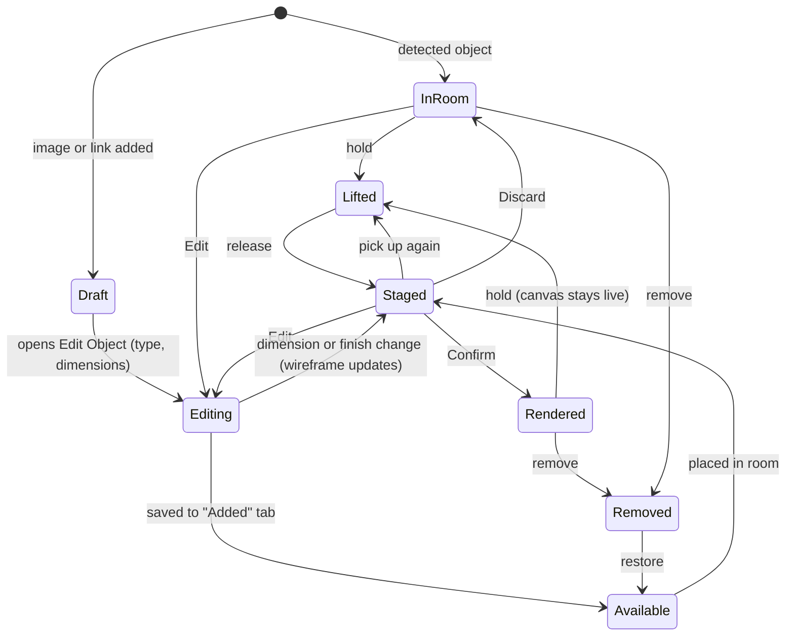
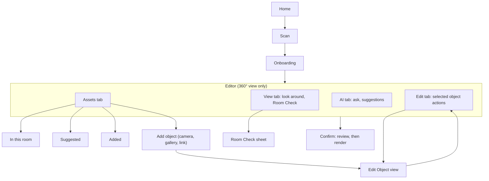

# Kith: Design Documentation

**Version:** 0.3 working draft, 2026-11-10. Revision 2 added: 3D rendering instead of image generation (D-27), the room model accepted as the base (D-28), Adapt deferred (D-29), the Block / Warn / Inform model (D-30), a block register, a restructured onboarding proposal, and a threshold register. Revision 3 added: invisible blocks and sealing the entrance as a Warn (D-31), the six onboarding options (D-32), an onboarding experience outline (F1.2), scripted added objects with a prepared set (D-33), passive and active feedback with an escalation ladder (D-34, 4.6.3a), and a correction flow for misidentified things (F8). Revision 4 added: signal families (4.6.4), the marker on the object in a clash (D-36), the Main / Sometimes sorting screen (F1.3), a revised window-blocking rule (T-07), and a link to the new journey map.
**Purpose:** a complete written definition of the product before the prototype is rebuilt. It describes what Kith is, what problem it solves, how it works, how people move through it, and what the sample room makes possible. It contains no screen designs.
**Companion file:** [kith-open-questions.md](./kith-open-questions.md) holds the decision log (`D-xx`) and every open question (`A-1`, `C-4`, and so on). This document refers to both by ID.

**How statements are labelled**

| Label | Meaning |
|---|---|
| **Decided** | The team has decided this (see the decision log). |
| **Proposed** | My recommendation to fill a gap. The team should accept, change or reject it. |
| **Open** | Not decided. Points to a question ID. |
| **Derived** | Calculated from the existing room data in the codebase. Must be verified against the real room. |

**Sources:** the problem-definition board (target users, scope, out of scope, problem, goals, limitations, affinity insights, HMW statements); the team's written answers of 2026-11-10; `PROTOTYPE.md`; the `plan/` documents; the room data in `src/data/`.

---

## Index

1. [Problem and project framing](#1-problem-and-project-framing)
2. [Product concept and design principles](#2-product-concept-and-design-principles)
3. [State of the product today](#3-state-of-the-product-today)
4. [How the product works](#4-how-the-product-works)
5. [Core flows](#5-core-flows)
6. [User journeys](#6-user-journeys)
7. [The sample room: Aarav's Room](#7-the-sample-room-aaravs-room)
8. [Information architecture and language](#8-information-architecture-and-language)
9. [Prototype approach for the rebuild](#9-prototype-approach-for-the-rebuild)
10. [Appendix](#10-appendix)

---

## 1. Problem and project framing

### 1.1 Problem statement

People with multifaceted needs face difficulty establishing a personal living space within limited physical constraints. Making one space work across personal, functional, social, recreational and lifestyle needs requires them to imagine possibilities, physically experiment, and negotiate competing options, often discovering only through trial and error whether a setup actually works for them.

### 1.2 Target users

People who have primary control over a limited living space and need to shape it around the different ways they live, work, relax, pursue interests and express themselves.

The sample user in the prototype is **Aarav**, living in a compact rented bedroom that doubles as study and getting-ready space. *Updated by DEC-059 (2026-11-11): Aarav, 27, has moved back to his hometown for a remote job. He lives in this compact room.*

### 1.3 Scope

How people living in compact personal spaces configure, personalise, evaluate and adapt their environments to accommodate multiple activities, competing needs and changing ways of living. Supporting agency, experimentation, enjoyment, ownership and a personal sense of being.

**Capabilities in scope for the rebuild** (new items from the 2026-11-10 decisions are marked ★):

| Capability | Status |
|---|---|
| Capture a room (360°) or a single zone (photo) | Room: in scope (simulated). Zone: a tile on Home only, no flow this round (DEC-003, DEC-008) |
| Onboarding that collects mood references, room description, activities, priorities | In scope |
| Redesign editor: hold, drag, stage and confirm furniture on a 360° view | In scope |
| ★ Edit Object view: correct detected dimensions, change finish with AI | In scope (D-01 to D-05, D-11) |
| ★ Add objects by image or product link | In scope (D-07 to D-12) |
| ★ Constraint guidance: room facts and user priorities made visible while placing objects | In scope (D-13 to D-21) |
| Refine mode (surface changes only) | **Dropped** (DEC-002) |
| Saving or comparing arrangements (the "Adapt" need) | Saving, reopening and duplicating layouts: **in scope** (DEC-004, DEC-009). Comparing: deferred |

> Updated by DEC-002, DEC-003, DEC-004 and DEC-009 (2026-11-11).
> - Refine is dropped, together with the Redesign/Refine choice in onboarding.
> - Zone stays on Home as a tile that does nothing yet. As a concept, a Zone is one photo of one section of the room, for fine work the room view is too coarse for, such as posters on a wall or arranging a desk top.
> - Layouts can be saved, reopened and duplicated. See [spec/decisions.md](../spec/decisions.md).

### 1.4 Out of scope, and boundary notes

Out of scope (from the board): architectural or structural modification; furniture design or replacement as the primary intervention; storage, decluttering or organisation as standalone problems; shared or communal spaces; finding a single optimal configuration.

The new decisions sit close to some of these lines. Each boundary needs to be held deliberately:

| New capability | Out-of-scope item it brushes against | The boundary we hold |
|---|---|---|
| Add object by image or link | Furniture replacement; shopping (`plan/08`) | The user brings an object they already have, or have seen, in order to *test it in their room*. No catalogue, no search, no prices, no basket. |
| Edit dimensions | Furniture replacement | Editing *corrects a size to the real one* (D-02). It applies to every object, including added ones, whose size is often an estimate from a photo (DEC-010). It is not a tool for trying a bigger version of your own desk. Add a different desk instead. |
| Constraint guidance, suggestions | A single optimal configuration | The system explains trade-offs and offers *options*, never a "best" layout (D-19). The user can override everything. |
| "Change with AI" in Edit Object | Furniture design | Finish only: colour, material, style (A-7, *Proposed*). |

### 1.5 Goals

1. Make spatial possibilities easier to explore.
2. Reduce reliance on physical trial and error.
3. Enable more informed spatial decisions.
4. Support meaningful personalisation.
5. Enable the space to evolve with the person.

### 1.6 Limitations and how the product responds

The board lists real limits. The product should be designed *around* them, not hide them.

| Limitation (from the board) | Design response |
|---|---|
| A digital experience can't perfectly predict lived experience. | Guidance is phrased as "heads-up", never as a verdict. Soft qualities (air, noise, atmosphere) are labelled as judgments, not measurements. |
| User input may be incomplete or inaccurate. | Dimensions are detected, then **user-correctable** with the source of each value shown (D-01). |
| Preferences are hard to capture and translate digitally. | Preferences come from low-effort pills and keywords, and the editor shows *which* preference triggered a heads-up so the user can correct it (F-2, F-3). |
| Some qualities are hard to represent (environment, atmosphere, noise, emotional attachment). | Only qualities with a defensible geometric proxy are checked (C-6). The rest are acknowledged, not faked. |
| An evaluated possibility still needs real-world validation before permanent changes. | Nothing is presented as final. Heads-ups can say "worth checking in the room". |
| Cannot account for every future change or need. | Partly addressed: layouts can be saved, reopened and duplicated, so a new arrangement can start from an old one (DEC-004, DEC-009). Comparing layouts is deferred. |
| Findings may not represent all people living in constrained spaces. | The sample room is one room. The rebuild should be tested with at least two other room types before generalising. |

### 1.7 From insight to capability

| Affinity insight (board) | HMW | Capability in the rebuild | Coverage |
|---|---|---|---|
| People find value in the *process* of shaping and reshaping, not in arriving at a final layout. | **Imagine**: make it easy and fast to imagine object, lighting and decor possibilities. | Hold-and-drag editing on the 360° view; ★ add objects by image or link. | Strong |
| In a compact room, choices have trade-offs between what an arrangement enables and what it limits. | **Negotiate**: help people understand the consequences and trade-offs of spatial choices. | ★ Constraint guidance: fixed-element signals while dragging, heads-up on drop, options with trade-offs. | Strong (new) |
| People can imagine configurations but can't know how well they will work until they experience or test them. | **Evaluate**: help people evaluate configurations before physically implementing. | Staging, Confirm-to-render, Room Check, constraint checks that keep running after Confirm (D-Q11). | Strong |
| People shape spaces around their own routines, preferences and identity. | **Personalise**: help people infuse personality, routines, interests and preferences. | Mood references, activities, ranked priorities that drive soft constraints; ★ objects the user chooses to add; AI finish changes. | Medium |
| People need spaces that evolve, while keeping the effort of change manageable. | **Adapt**: help people establish a baseline that supports adaptability as needs change. | Save, reopen and duplicate layouts (DEC-004, DEC-009). | Small |

---

## 2. Product concept and design principles

### 2.1 Concept

Kith lets a person redesign a compact room by experimenting visually, quickly and easily, before moving any real furniture.

The product is built on **editing 360° images**, not on LiDAR or true 3D reconstruction. In the intended product, scanning a room would:

1. Produce a clean **base layer**: the empty room with all movable furniture removed.
2. Identify the **fixed elements** the user cannot change: windows, doors, built-in furniture, electrical points, light points. These are the room's hard constraints.
3. Cut each **movable object** into its own image layer.
4. Build a simple **box model** of the room (floor, ceiling, four walls) so that objects have a position and a size in real space.

The prototype fakes all of this with a procedural 3D room (three.js) and scripted content. It is a **Wizard of Oz** build: nothing is analysed or generated live.

**Prototype scope (Decided, D-27, D-28).** This is a concept prototype. There are no 360° images and no image generation in it. The room is the existing 3D room model, and it is the only room. Moving, resizing and adding objects shows **bounding boxes** while staged. When the user taps **Confirm**, each object appears as a **3D model** at its position and size. The 360° image pipeline above describes the intended product and is for a later phase.

> Updated by DEC-001 (2026-11-11): the screen specs follow the **test prototype** described in this paragraph. The canvas is the 3D room. Staged objects are bounding boxes. Confirm shows 3D models. Scanning, detection, added objects and the AI are scripted.

### 2.2 Design principles

| # | Principle | What it means in practice |
|---|---|---|
| P1 | **Agency over automation** | The system informs, the user decides. Nothing is ever forced, except an object cannot be placed where the picture would break (inside a wall). |
| P2 | **Automatic by default, no numbers in the flow** *(revised from "no numbers at all")* | The app detects sizes and judges clearances itself. Numbers are not shown while moving objects or reading heads-ups (D-06). The **one** place numbers appear is the Edit Object view, because correcting a size needs them (D-01, D-03). |
| P3 | **Tactile** | Moving furniture feels like moving a sticker on a photo. No resize handles or 3D gizmos on the canvas (D-03). |
| P4 | **No dead ends** | After rendering, the canvas stays live. Dismissed heads-ups can be found again. Priorities can be changed after onboarding. |

> Updated by DEC-022 and DEC-024 (2026-11-11): dismissed heads-ups are **not** restorable. A kept check returns only if the situation really changes (§4.6.6). Priorities are changed in project settings.
| P5 | **Less typing** | Pills, presets, suggestions and detected values do the remembering. |
| P6 | **Facts before opinions** *(new)* | The room's non-negotiable facts are shown clearly and calmly, before any preference-based comment. |
| P7 | **Remember what the user decided** *(new)* | A dismissed heads-up stays dismissed unless the situation materially changes (D-21). |
| P8 | **Honest about fidelity** *(new)* | Every object and dimension shows where it came from (detected, edited, from a product page, estimated). A wireframe is visibly a stand-in until Confirm. |

---

## 3. State of the product today

### 3.1 What exists

| Part | State |
|---|---|
| Home (Space / Zone browse, last project as a 360° hero, two capture tiles) | Built |
| Scan (simulated, 360° room or single photo) | Built |
| Onboarding, five steps (name and mood boards; Redesign or Refine; describe the room; what matters most; processing) | Built |
| Redesign editor: 360° view only, four bottom tabs (View, Edit, AI, Assets) | Built |
| Hold, bounding box, drag with wall snapping and distance scaling, staging, Confirm | Built |
| Assets drawer with Owned and Suggested items; drag-out or tap to stage | Built, scripted |
| Scripted ten-step scenario that drives the room's state | Built |
| AI assistant (proxy to a language model, constrained to the scenario) | Built |
| Refine editor | **Undefined** |
| Dimension editing, adding objects, constraint guidance | **Not built** (this document) |

### 3.2 What is faked

- Scanning, base-layer creation, object cut-outs, the room box: pre-made for one room.
- Detection of room type, activities and priorities: pre-written for the sample room.
- Confirm: today the result is a pre-made scripted outcome. In the rebuild, Confirm shows the object as a 3D model (D-27).
- The editor shows a procedural 3D room, not the scanned photo. This stays for the whole prototype (D-27).

### 3.3 Gaps against the new requirements

| Requirement | Gap in the current build |
|---|---|
| Edit Object view (D-11) | None exists. `canEditSpecs` exists only on fixed elements in the data, with no interface. |
| Add objects by image or link (D-07 to D-12) | The drawer has a fixed list of 14 items, half of them scripted story props. No input path for new objects. |
| Constraint guidance (D-13 to D-21) | None live. `plan/05` describes a cue matrix but it was never turned into rules. The room's state is a bag of yes/no flags (`ScenarioState`) that the story script flips, not geometry that rules can judge. |
| Onboarding drives the editor (D-23) | Priorities and activities are collected but not read by any rule. |
| Dismissal memory (D-21) | Nothing to remember. |

### 3.4 Why a fresh build is justified

These are observations from the code, not criticism:

1. **The room has three descriptions that disagree.** `mockData.ts` (`INITIAL_ROOM_OBJECTS`), `identificationData.ts`, and `mockData.ts` (`DETECTED_BASELINE_OBJECTS`) describe the same room in different shapes (a dimension string, a tuple, a position by angle). Section 7.6 lists concrete mismatches. Rules need one trusted source.
2. **Story drives state.** Positions are *scenario steps*, not coordinates, so a rule cannot ask "how far is the desk from the plug?" for an arbitrary placement.
3. **Free placement is the point of the new scope.** Dimension edits, added objects and live guidance all need real positions and sizes.

---

## 4. How the product works

> Superseded for 4.1 to 4.6 by [spec/modules/canvas.md](../spec/modules/canvas.md), [spec/modules/ai.md](../spec/modules/ai.md) and [spec/modules/guidance.md](../spec/modules/guidance.md) (2026-11-11). Section 4.7, the rule structure, still applies.

### 4.1 The layer model

> Superseded by [spec/modules/canvas.md](../spec/modules/canvas.md) (2026-11-11).

Everything on screen belongs to one of five layers (bottom to top).

| # | Layer | Contents | Editable by user? |
|---|---|---|---|
| 1 | **Base room** | Clean 360° image of the empty room | No |
| 2 | **Fixed elements** | Door, windows, built-in wardrobe, plug points and switchboards, AC, ceiling fan, tube light. Part of the base image, but known to the system as objects with a position, a size and a **derived zone** (door swing, access area, reach area) | Not in normal editing (A-1) |
| 3 | **Object layers** | Each movable object as its own image layer (detected, suggested or added) | Yes |
| 4 | **Staging layer** | Wireframe bounding boxes for objects that have been lifted, moved, resized or newly added and not yet confirmed | Yes |
| 5 | **Guidance layer** | Signals produced by the constraint system (tints, zones, sightlines, ghost positions, heads-up cards) | No, system-generated |

**Prototype note (D-27):** in the rebuild, layer 1 is the 3D room and layer 3 is 3D objects, not 360° images. The layer model, the object model and the rules are the same. Only what draws them differs.

### 4.2 The object model

> Superseded by [spec/modules/canvas.md](../spec/modules/canvas.md) §6 (2026-11-11).

Every object, whatever its origin, has the same attributes. This is what makes the Edit Object view identical for all of them (D-11).

| Attribute | Values | Notes |
|---|---|---|
| **Origin** | *Detected* · *Suggested* · *Added* | Shown as a badge. Maps to the three Assets tabs (B-1). |
| **Type** | bed, desk, chair, storage, mirror/vanity, fan, rug, lamp, plant, … | Decides which rules apply (D-22, B-4). For added objects the system guesses and the user confirms. |
| **Plane** | floor, wall (first build); ceiling, on-surface (later, B-5) | Constrains where it can be dragged. |
| **Dimensions** (W × D × H) | with a **source**: *Detected* · *You edited* · *From product page* · *Estimated from photo* | The bounding box is built from these. Visible only in Edit Object (D-06). |
| **Needs** | power, daylight, front access, ventilation, privacy | Defaults by type, adjustable (C-3). |
| **Position and facing** | floor coordinates, wall coordinates | Not shown as numbers. |
| **Look** | A 3D model with a finish (colour, material). Later phase: a generated image layer | In the prototype, a model per object type scaled to its box (D-27, D-33). Finish is changed in Edit Object. |
| **Link** | optional partner (desk + chair, dressing table + stool) | C-10. |
| **Display state** | *placed (3D model)* · *lifted or staged (wireframe box)* | See the state diagram below. In the diagram, "Rendered" means "shown as a 3D model". |

### 4.3 Object states

> Superseded by [spec/modules/canvas.md](../spec/modules/canvas.md) §6 (2026-11-11).



The key rule, **Decided** (D-04, D-27): *while staged, an object is only a bounding box. On Confirm it appears as a 3D model at its position and size.* Moves, resizes and adds are all shown as wireframes in the meantime.

### 4.4 Dimension refinement

> Superseded by [spec/modules/canvas.md](../spec/modules/canvas.md) §8 (2026-11-11).

**Decided:** dimensions are detected automatically; the user may correct them in Edit Object (D-01 to D-05).

| Aspect | Definition |
|---|---|
| Purpose | Correct a wrong detection ("my bed is longer than that"), or a size estimated from a photo for an added object ("my mat is longer than that", DEC-010). Not for exploring other sizes (D-02). |
| Where | Only in the Edit Object view. No resize handle on the canvas (D-03). |
| What the user sees | Width, depth and height fields with the detected value alongside; a "Reset to detected" action; a source chip. *Proposed:* proportion lock on by default (A-3), type-based limits (A-4). |
| What happens on change | The bounding box (wireframe) updates in the room. The object becomes *Staged*. Rendering happens at Confirm (D-04). |
| What is recalculated | Every rule check that involves this object, as subject or neighbour (A-6, to confirm). No other object's own size changes (D-05). |
| Fixed elements | Not editable in this prototype. The room model is the accepted base (D-28). |

### 4.5 Adding objects

> Superseded by [spec/modules/canvas.md](../spec/modules/canvas.md) §7 (2026-11-11). The objects that can be added are set in step 3.

**Decided:** by image (camera or gallery) or by product link. The system builds a bounding box from the image and, on Confirm, renders the object using the image as visual reference and the box as geometric reference (D-07 to D-12).

**Prototype scope (D-27, D-33):** everything added is **scripted**. There is a prepared set of images. The user picks one, and each already has a prepared type, bounding box and 3D model. It then behaves like every other object: a bounding box while staged, a 3D model on Confirm.

```
Add (Assets tab)
  └─ Source pop-up: Camera · Gallery · Product link
       └─ Image chosen (or link resolved to image + dimensions)
            └─ System: isolates object, guesses type, builds bounding box
                 └─ Edit Object view  (type · dimensions · finish)
                      └─ Saved to the "Added" tab  → place in room → Confirm
```

| Input | What the system gets | Dimension quality |
|---|---|---|
| Camera or gallery image | Picture only | **Estimated from photo**: lowest confidence, labelled as such |
| Product link | Picture, and dimensions if the page has them | **From product page**: higher confidence. If the page has no dimensions, falls back to *Estimated* |

The three Assets groups (B-1, *Proposed* names):

| Group | What it holds | Source |
|---|---|---|
| **In this room** | Everything detected in the scan | Scan |
| **Suggested** | Things the user's references show that the room lacks | Mood board and references (D-09) |
| **Added** | Things the user brought | Image or link |

> Updated by DEC-033 and DEC-037 (2026-11-11): the groups are **Your room · Added · Suggested**. A removed object goes back to Assets, into "Your room" if it was detected or "Added" if the user added it. There is no separate Removed group.

Suggested objects are generic stand-ins with generic sizes. They are rule-checked and editable exactly like the others (B-10).

**The prepared set for the prototype (Provisional, B-13, D-37).** The set is to be defined from the user journeys; see [kith-user-journeys.md](./kith-user-journeys.md), which recommends a smaller set. The five below are a placeholder, chosen so that each one exercises a different rule. They avoid duplicating the existing Suggested items (rug, plant, lamp with storage, divider).

| # | Object | Plane | Needs | Entry path and source chip | What it lets us test |
|---|---|---|---|---|---|
| 1 | Armchair | Floor | Space around it | Gallery. *Estimated from photo* | Walkway (H-9, S-10), door swing (H-3), seating for guests (S-7), and the "approximate" cue (H4) |
| 2 | Small TV on a low stand | Floor | Power | Link. *From product page* | A **second** powered object for the plug connection line (H-6), plus window glare (S-2) |
| 3 | Tall narrow bookcase | Floor | Front access | Gallery. *Estimated from photo* | Blocking a window (H-8, taller than the sill), and acting as a **privacy screen** (S-1, T-11) |
| 4 | Wall mirror | Wall | None | Link. *From product page* | Wall-plane behaviour (B-B) with no floor rules |
| 5 | Yoga mat | Floor, flat | Clear floor | Gallery. *Estimated from photo* | The open-floor patch (S-4) and the entry-area conflict (section 7.5) |

How the three entry options behave when scripted: **Gallery** shows the prepared images. **Camera** opens a simulated capture that resolves to one of them. A pasted **link**, whatever it is, resolves to the next prepared "link" object.

### 4.6 The constraint and guidance system

> Superseded by [spec/modules/guidance.md](../spec/modules/guidance.md) and, for the card, Show options and the AI's role, [spec/modules/ai.md](../spec/modules/ai.md) (2026-11-11).

This is the largest new piece of the product. It turns *"it is hard to keep track of every constraint while imagining"* (the user's words) into something the room does for them.

**Purpose (Decided, D-13):** make constraints clear so the user has the information, then lets them choose, including choosing to ignore it.

#### 4.6.1 Two kinds of constraint

> Updated by DEC-029 (2026-11-11): soft constraints apply only when the user picked them, as a priority or as an activity. Unpicked qualities are not watched. Room facts are always watched.

| | **Hard: "Room facts"** | **Soft: "Your priorities"** |
|---|---|---|
| Source | The room itself | The user (onboarding) and the room's general qualities |
| Examples | Door and its swing; built-in wardrobe; windows; plug points; AC; solid objects can't overlap; a bed can't block the entry | Privacy, natural light, ventilation, open floor, storage; activity zones; airflow as a low-priority default |
| Same for every user | Yes | No. Depends on what the user chose |
| Priority | Always first | User-selected = high, ordered by selection; unselected defaults = low (D-15, C-4) |

#### 4.6.2 Three response levels (Decided, D-30, D-31)

| Level | When | What the system does | User can override? |
|---|---|---|---|
| **Block** | The scene would be physically impossible (see the block register below) | **Nothing is shown.** The object simply won't go there. It slides to the nearest valid spot. No message, no card, no colour (D-31) | No |
| **Warn** | Possible but causes a real problem: blocks the door's swing, seals the entrance, blocks a window, far from a plug, blocks the wardrobe, makes a walkway impassable | Passive signals while dragging, then an active heads-up on drop. How loud it is depends on the escalation ladder (4.6.3a) | Yes |
| **Inform** | Soft preference not met, or a low-priority side effect | Quiet note, in Room Check and in the Confirm review. Pop-up only for high-priority soft items | Yes |

**Block register (the team adopted the Block / Warn / Inform model, D-30).**

**A block is invisible (Decided, D-31).** It is built into how objects move, like gravity. The user is simply unable to do it, and the system says nothing about it.

The test for a block: *would allowing it make the 3D scene physically contradictory, or leave the object with nowhere valid to be?* If not, it is a Warn at most. Every block removes some of the user's freedom (P1), so the list is short on purpose.

| ID | What is blocked | Why a block, not a warn | What the user sees | Kind |
|---|---|---|---|---|
| B-A | Any part of an object going outside the room: through a wall, the ceiling or the floor | The room is the only space that exists | The object stops at the boundary | Technical, good practice |
| B-B | An object off its plane: a floor object off the floor, a wall object off a wall | Part of the object model (4.2) | The object stays attached to its plane | Technical |
| B-C | Overlapping a fixed solid: the wardrobe volume or the AC unit | Two solids cannot share space | The object slides to the nearest free spot | Physical |
| B-D | Overlapping another solid object. Allowed pairs: a rug under furniture, a chair or stool tucked under its desk or table | Same | The object slides aside, or settles in the "tucked" position for an allowed pair | Physical |
| B-F | Impossible dimension values in Edit Object: zero, larger than the room, or outside the limits for the object's type | An input guard, not a placement | The field stops at its limit, like a stepper at its end | Input guard |

*B-E (sealing the entrance) was moved out of this register. It is now the Warn rule H-10 (D-31).*

**Notes**

- **Every block is physics or input validation, never a judgment.** Anything that depends on a judgment about the room (a bed that seals the entrance, a desk far from a plug) is a Warn, so the user always keeps the choice (D-31).
- **One small exception to "invisible":** a typed dimension that hits a limit (B-F). The field stops at the limit. If testing shows people are confused by a field that ignores a number, add a one-line hint then, not before.
- **Slide, don't snap back.** When a block applies, the object slides to the nearest valid spot instead of returning to where it started. The object stays under the finger and the user does not lose their drag.
- **The starting layout is never blocked or flagged by B-D.** The room data has a few overlaps (the pedestal fan and the bed, the chair tucked into the desk). They belong to the accepted room model (D-28), so overlap rules apply only to the user's moves.
- **Not blocked, only Warn:** door swing, wardrobe access, a blocked window, a plug out of reach or hidden, a narrow walkway. All soft constraints are Inform.

#### 4.6.3 When feedback appears

| Moment | What the user sees | Detail |
|---|---|---|
| **While dragging** | Fixed elements and floor zones that matter to *this* object change state, using the signal vocabulary below | No numbers (D-06). Only signals relevant to the dragged object's type and within an attention radius. At most two at once, hard before soft (D-Q2) |
| **On drop** | If the placement is in a **Warn** or high-priority **Inform** state: a non-modal heads-up card | Reason in plain words. Buttons: **Keep it · Undo · Show options** (D-17, D-18, D-Q5) |
| **At Confirm** | One review of anything unresolved | Calm summary, not a gate: the user can confirm anyway |
| **Anytime** | **Room Check**: current heads-ups and dismissed ones | Restore a dismissed heads-up; change priorities (D-Q9, F-3) |

> Updated by DEC-022 (2026-11-11): **Room Check** is a button in the top bar. It shows the count of open checks, including problems that were there before any change. Each item takes you to its object and opens the card. **Clear checks** asks for confirmation, then clears everything, and can't be undone. Kept checks are not listed and can't be restored. Priorities live in project settings (DEC-024).

#### 4.6.3a Passive and active feedback: what to show, and when (Proposed)

The team's framing (D-34): feedback comes in two modes.

| Mode | When | What the system does | What the user does |
|---|---|---|---|
| **Passive** | While an object is being dragged | Shows live, silent signals. Never interrupts | Watches, and adjusts as they move |
| **Active** | After the object is dropped | Speaks up, once, about a problem it found | Ignores it, keeps the placement, undoes it, or explores options |

**Passive feedback** is the signal vocabulary in 4.6.4. The rules: only things relevant to the dragged object; only inside the attention radius (T-17); at most two at once, hard before soft; no numbers; every colour has a second cue. In the plug example, a thin line is drawn from the object to the nearest usable plug, and the plug goes from green toward red as the placement gets worse. The user reads it as: "this is connected, and the connection is being stretched."

**Active feedback: options considered**

| Option | What it is | For | Against |
|---|---|---|---|
| **1. Marker only** | A small indicator stays on the object (an amber dot). Tap to read the reason | No interruption; the user stays in flow | Easy to miss. A real problem (the door can't open) can go unseen until after Confirm |
| **2. Non-modal card** | A card slides up at the bottom with the reason and choices. The room stays visible and usable | Visible but not blocking. The user can ignore it and carry on | Competes for space on a phone. Repeated cards feel like nagging |
| **3. Modal dialog** | A dialog that must be answered before continuing | Impossible to miss | Contradicts agency (P1). Breaks the flow of experimenting. Users learn to dismiss it unread |
| **4. Dedicated decision view** | A separate screen that compares the new placement with the old one and asks "go ahead or not?" | Space to explain and compare | Takes the user out of the room they are judging. Heavy for a quick experiment. Turns a choice into a gate |
| **5. Deferred review** | Nothing on drop. Every problem is listed once at Confirm | Least interrupting. Good for a batch of changes | Feedback arrives long after the move that caused it, so the user can't tell which move was the cause |

**Recommendation: an escalation ladder.** How loud the active response is depends on four factors.

> Updated by DEC-019 (2026-11-11): adopted, with one change. A **card on drop** appears only for room facts (the door, the entrance, a plug the object needs, a window, the wardrobe, the walkway) and for the user's ranked priorities. Everything else is a **marker**. Tapping a marker opens its card. Blocks stay silent (DEC-020).

| Factor | Question | Effect |
|---|---|---|
| **Severity** | Warn (a real problem) or Inform (a preference)? | Warn goes higher |
| **Priority** | Is it the user's top-ranked priority or a low default? | A higher rank goes higher |
| **Certainty** | Does it rest on a confident detection and a known size, or on an estimate? | Less certain: softer wording and one level lower |
| **Novelty** | New, or already dismissed? | Dismissed items don't return unless the situation changes (4.6.6) |

| Level | What the user sees | Used for |
|---|---|---|
| **L0 Silent** | Nothing. The user simply can't do it | Blocks (D-31) |
| **L1 Marker** | A small indicator on the object. Tap to read. Counted in Room Check | Low-priority Inform; anything resting on uncertain data |
| **L2 Card** | A non-modal card on drop: the reason and **Keep it · Undo · Show options**. If the user ignores it and moves on, it collapses to an L1 marker **attached to the object in the clash** and stays *open* (not dismissed) (D-36) | Warn; high-priority Inform |
| **L3 Confirm review** | One non-blocking sheet at Confirm listing what is still open. "Confirm anyway" is always there | Everything unresolved, once, before the objects are placed |

Options 3 and 4 are **not used**, except that the Confirm review is a light version of option 4. Both pull the user away from the room and turn guidance into a gate, against P1 and P4. So the answer to "do we take them to a specific view?" is no, apart from the optional Confirm review.

**Timing and behaviour**

- The card appears on release. If the user picks the object up again within about a second, the card disappears and nothing counts as dismissed.
- The card never covers the object or the element it is about.
- One card at a time. Extra issues sit behind a "2 more things to know" chip (conflict option C). *Changed by DEC-040 (2026-11-11): extra issues are a **stack of cards** ("1 of 3", swipe or ‹ ›), room facts first. The marker shows the count. While the tap menu is open, the marker becomes a badge on Ask.*
- Ignoring a card is not dismissing it. Only **Keep it** dismisses.

**The marker (Decided, D-36).**
- It is attached to the object the user placed, because that is the object they can act on. If the clash involves two movable objects, it sits on the one just moved.
- Amber for a Warn, neutral for an Inform.
- Tapping it reopens the card and softly highlights the other thing involved (the plug, the door zone, the second object).
- It disappears by itself when the clash is resolved, for example when the user moves the object, or the object in the way.
- It stays after Confirm until the clash is resolved or the user taps **Keep it**.

**First-drop matrix (Proposed)**

| Rule | Passive (while dragging) | Active on first drop |
|---|---|---|
| H-3 Door swing | Floor zone near the door | L2 card |
| H-10 Entrance sealed | Floor zone | L2 card, strongest wording |
| H-5 Wardrobe access | Tint and floor zone | L2 card |
| H-6 Plug reach, *stretch* | Connection line and plug tint (amber) | L1 marker |
| H-6 Plug reach, *problem* | Connection line and plug tint (red) | L2 card |
| H-7 Needed plug hidden | Plug tint | L2 card |
| H-8 Window blocked | Edge glow | L2 card |
| H-9 Walkway not passable | Floor zone | L2 card |
| S-1 Privacy, ranked first or second | Sightline | L2 card |
| S-1 Privacy, ranked third or unranked | Sightline | L1 marker |
| S-2 to S-10, low priority | None, or a very faint cue | L1 marker |
| Anything resting on estimated data | As above | One level lower, "we think" wording |

**What the card says.** One sentence: the reason, the priority behind it, and a hedge when the data is uncertain ("We think…"). It includes a small **Not right?** link (F8), so a wrong detection can be corrected at the moment it matters.

#### 4.6.4 Signal vocabulary (Proposed, D-Q1)

**Which signal for which relationship.** Not every rule is a connection like the plug. Each rule declares the *kind of relationship* it checks, and that kind decides the signal (D-Q18). The plug is the "reach" kind: a connection line plus a tint (D-35).

| Relationship | Plain meaning | Signal | Examples in this room |
|---|---|---|---|
| **Reach** | The object needs something nearby. Closer is better | **Connection line + element tint** | Desk, TV or lamp to a plug (H-6). Desk to a window for daylight (S-2) |
| **Keep clear** | A space must stay free | **Floor zone**, or **edge glow** for a window | Door swing (H-3), entry (H-10), wardrobe front (H-5), window access (H-8), walkways (H-9, S-10), the open-floor patch (S-4) |
| **Line of sight** | What can be seen from where | **Sightline** | Door to bed, desk or dressing area (S-1). TV and window glare (S-2) |
| **Keep apart** | Something is better *away* from a source | **Floor zone under the source**, no line | Bed under the AC outflow (S-6) |
| **Ambient** | A general quality with no single position | **None while dragging**, a marker after the drop | Airflow (S-3), seating for guests (S-7) |
| **Overlap** | Two solids in one place | **Nothing. An invisible block** | Block register B-A to B-D |

**Why only "reach" gets a line.** A line says "this is connected to that, and the connection can stretch". That only reads correctly when *closer is better*. For "keep apart", a line that turns red as the bed gets closer to the AC would read backwards, so it is shown as a zone. For "keep clear" there is nothing to connect, only a space to respect.

**"Usable" plug.** The line goes to the nearest *usable* plug, meaning one that is not hidden behind an object (H-7). In the starting layout the pedestal fan stands in front of the south plug, so a desk moved to the south windows starts with a clash that another object causes (journey J2).

**Where the signal attaches.** The passive signal sits on the fixed element (plug, door zone, window). The active marker sits on the object the user placed (D-36).

Every signal has a **colour state** and a **second cue**, so colour is never the only carrier (D-Q3).

| Signal | Used for | Behaviour | Second cue |
|---|---|---|---|
| **Connection and tint** | Plug points (reach); the wardrobe front | A thin **connection line** runs live from the dragged object to the nearest usable plug, and the plug itself changes **green → amber → red** as the position gets better or worse (D-16, D-Q14). No numbers | Line style: solid (fine), dashed (stretch), broken (problem). Plus a ring on the plug: complete, dashed, or with a break |
| **Floor zone** | Door swing; wardrobe access; walkway between objects; protected activity zone | A soft shape on the floor. Turns amber when the dragged object overlaps it | Zone outline changes from solid to hatched |
| **Edge glow** | Windows (blocked, or still reachable) | The window frame glows brighter when open and dims when the object would block it | Small open/closed glyph at the frame |
| **Sightline** | Privacy from the door | A soft ray from the door toward the bed or desk, clear or interrupted | Ray ends in a small eye glyph, struck through when interrupted |
| **Ghost position** | "Show options" | 2 or 3 semi-transparent copies of the object at alternative spots, each with a one-line trade-off | Numbered tags 1, 2, 3 |

> Updated by DEC-032 (2026-11-11): Show options always offers 2 or 3 options, each with what it costs. When none is clean, it says "Each of these gives something up." An option may involve moving another object ("if the fan goes"). It never says "best".

Three states, **fine / stretch / problem**, with a smooth blend between them (D-Q4). Naming of the states is internal; the UI shows only the signal.

> Updated by DEC-041 (2026-11-11): the signal set is adopted, but **one signal at a time** while dragging (the most serious, room facts first), not two. The sightline appears only if Privacy was picked (DEC-029).

#### 4.6.5 The heads-up card

| Part | Content | Example (written for Aarav's room) |
|---|---|---|
| Reason | One sentence, no numbers, names the priority if there is one | "The desk would be a long way from a plug." / "From the door, your screen would be in view, and you chose Privacy." |
| Actions | **Keep it** (dismiss and remember) · **Undo** (return to the previous spot) · **Show options** (ghost positions). Plus a small **Not right?** link that opens the correction flow (F8) | |
| Extra items | A chip "2 more things to know" expands the rest (option C in the register) | |

#### 4.6.6 Dismissal and memory (D-21)

- **Keep it** stores a dismissal for the pair *(object, rule)*.
- The heads-up returns only if the situation materially changes: the object moves to a different problem spot, or its size is edited.
- A dismissed heads-up is listed in Room Check, where it can be restored (D-Q8). *Reversed by DEC-022 (2026-11-11): dismissals can't be restored. Only a real change in the situation brings a check back.*
- Dismissals are saved with the project (G-5).

#### 4.6.7 AI's role (D-19)

AI explains and suggests. It does not decide, move objects, or rank layouts as "best".

> Updated by DEC-018 and DEC-019 (2026-11-11).
> - A change the AI makes is a **proposal** on the canvas, with **Apply** and **Not now**. The user's tap on Apply is the tap this section requires.
> - The heads-up card is the AI's voice. It belongs to the AI, styled as the AI.

| AI does | AI never does |
|---|---|
| Writes the reason text of a heads-up | Moves an object without the user's tap |
| Proposes 2 or 3 alternative positions with a trade-off for each | Says "this is the right layout" |
| Matches free-text priorities to a known rule family (F-1, C-6) | Dismisses a heads-up on the user's behalf |
| Changes an object's **finish** when asked in Edit Object (A-7) | Changes an object's shape, type or size |

> Updated by DEC-025 and DEC-026 (2026-11-11).
> - The AI can also **add** objects, such as a Suggested item, as a proposal.
> - It can **restyle the whole room** from the look of the user's references. The change is applied object by object, and each object's Edit Object keeps its earlier finishes.
> - When asked for something it can't do, it redirects in one line: size, shape or type go to Edit Object; walls and fixed elements go to Room edit (DEC-028).

In the prototype, all AI output is scripted for the sample room (section 9).

### 4.7 The rule structure

**Decided:** logic is per room; objects are elements; type can change the logic (D-22). **No structure exists yet** (D-24). This is the proposed structure.

**Inputs**

| Input | Contents |
|---|---|
| **Room model** | Box dimensions, fixed elements with position, size and derived zones |
| **Object model** | Section 4.2 |
| **User context** | Ranked priorities, activities, dismissed heads-ups |

**A rule is one row** (E-2: kept outside the interface code so a designer can tune it):

| Field | Meaning |
|---|---|
| `id` | Short name, for example `H-DOOR-SWING` |
| `tier` | `hard` or `soft` |
| `appliesTo` | Object types or planes it concerns |
| `activatedBy` | `always`, or a priority, or an activity |
| `test` | The geometry question ("does the footprint intersect the door swing zone?") |
| `parameters` | Named thresholds, each with a source note (C-8) |
| `response` | `block`, `warn` or `inform` |
| `signal` | Which signal from 4.6.4 |
| `message` | Plain-language reason template |
| `options` | How "Show options" should search for alternatives |

**Evaluation**: runs on drag (cheap checks only, to drive signals) and on drop and after every edit (all checks). Order of presentation: *Block → Warn → soft by user rank → low-priority soft*.

**Derived zones** for each fixed element are computed once from the room model: door swing, wardrobe access, window access, plug reach area, AC outflow, walkway strips. A change to a fixed element's configuration (for example the door's swing) recomputes its zone (A-1, C-12).

---

## 5. Core flows

Flows F1 to F6 and F8 are the ones the rebuild must support (F7, Refine, is undefined). Each flow lists what triggers it, what happens, edge cases, how the prototype fakes it, and where decisions are still open.

### F1. Start a project (existing, with one change)

`Home → Scan → Onboarding (5 steps) → Editor`

> Updated by DEC-002 and DEC-006 (2026-11-11). The order is now:
>
> `Home → Scan → preferences while the room is processed → "Here's what we found" → Editor`
>
> Step 2 (Redesign or Refine) is dropped. The table below is kept for its content.

| Step | What happens |
|---|---|
| Home | Browse Space / Zone. Start a new project (360° room) or zone (single photo) |
| Scan | Simulated capture. Continues with the sample room |
| Onboarding 1 | Name the project; add mood references (presets, gallery, Pinterest link) |
| Onboarding 2 | ~~Choose **Redesign** or **Refine**~~. Dropped (DEC-002) |
| Onboarding 3 | Room type and a short description are auto-filled. The user sorts activity bubbles into **Main** and **Sometimes** (F1.3), and the description is composed from them |
| Onboarding 4 | Pick what matters most. **Change:** selection order becomes priority rank (C-4); a line says "We'll watch these first" (F-2) |
| Onboarding 5 | Processing animation. Now runs while steps 1, 3 and 4 are answered (DEC-006) |

**New requirement on steps 3 and 4:** every option the user can pick must have a defined effect on the editor (C-6). Today nine keywords are offered and only five can be checked. The team asked for a more structured onboarding, so the next section proposes one.

#### F1.1 Proposed onboarding restructure (Proposed, C-13)

**Why:** Comfort, Calm and Easy to clean are *outcomes* of other choices, not things with a position in a room. Offering them promises a check that does not exist.

**Step 3, "How you use the room."** Each activity bubble creates a **need** and a **zone to protect**. The description is composed from the bubbles (F1.3).

| Activity | Need it creates | Rules it switches on |
|---|---|---|
| Resting | Bed with side access, away from the AC's direct flow | S-6, and bed access |
| Studying | Desk with daylight and a plug within reach | S-2, H-6 |
| Working out | A clear floor patch for a mat | S-4 |
| Getting ready | Mirror with light and room for the stool | S-9 |
| Hosting friends | Space for seating | S-7 |
| Art and hobbies | A surface with daylight | S-2 |
| Drying laundry | A window area kept free | S-8 |
| Keeping plants *(new, replaces the Plants keyword)* | Daylight where plants stand | S-2 |

> Updated by DEC-027 (2026-11-11): the activity list is now ten. Resting, **Working or studying**, **Gaming**, **Relaxing**, **Exercising** (was Working out), Getting ready, Hosting friends, **Hobbies** (was Art and hobbies), Drying laundry, Keeping plants. Gaming needs a screen without glare and a plug. Relaxing needs a seat and soft light. Their rules are written with the scenario (OI-057).

**Step 4, "What matters most."** A fixed list of six options. The user picks up to three, **in order of importance**. Each option shows one line saying what the system will watch.

| Option | Line shown to the user | Rules |
|---|---|---|
| Privacy | "We'll watch what can be seen from the door." | S-1 |
| Natural light | "We'll watch daylight at your desk and keep windows usable." | S-2, H-8 |
| Fresh air | "We'll watch that windows and fans aren't blocked." | S-3 |
| Open floor | "We'll watch clear floor and walking room." | S-4, S-10 |
| Easy storage access | "We'll watch that drawers and the wardrobe stay reachable." | S-5, H-5 |
| Restful sleep | "We'll watch the bed's position against the AC and the door." | S-6, S-1 |

- **Dropped as keywords:** Comfort, Calm, Easy to clean. Their intent is absorbed by the options above (Comfort → Restful sleep and Open floor; Calm → Open floor). Easy to clean has no geometric check and is dropped.
- **Something else:** free text is stored and shown back as "noted, not checked". It never pretends to be a rule. *Changed by DEC-039 (2026-11-11): the AI may switch a rule on from free text. Any rule it infers is shown to the user as a removable item in the recap and in Preferences, never switched on silently.*
- **Everything is still watched:** unselected options stay active at low priority (D-15). Selection only adds rank. *Reversed by DEC-029 (2026-11-11): unselected options are not watched. Selection switches a quality on and gives it a rank.*
- **Default selection:** Privacy, then Natural light (as in the sample story). To confirm.

This keeps D-15 (chosen = high priority, unchosen = low) and removes the unchecked options. The six options are accepted (D-32).

#### F1.2 Onboarding experience outline

What the user goes through, what the system captures, and how reliable it is. Values marked **~** are my estimates, not measurements.

**The experience at a glance**

| Step | What the user does | Effort (~) | What we capture | Type of information | Used for | How reliable |
|---|---|---|---|---|---|---|
| **1. Name and references** | Keeps or edits a pre-filled name. Adds inspiration (preset, gallery, Pinterest link) or skips | *If skipped, a default preset is selected and a pop-up says so (DEC-035).* 1 to 5 taps. Typing optional | Project name. Mood items (colours, materials, styles) | Taste. Visual and unstructured | Suggested tab, finish choices in Edit Object, AI wording | Low depth. A preset is a coarse stand-in for taste. Fine for suggestions, not for rules |
| **2. Redesign or Refine** (dropped, DEC-002) | One tap | 1 tap | Scope of intent: move things, or surface changes only | Intent. Structured (two values) | Which editor opens (only Redesign exists) | High. One clear choice |
| **3. Describe the room** | Confirms the auto-filled room type and description. Sorts activity bubbles into Main and Sometimes (F1.3) | 2 to 5 drags or taps. Typing optional | Room type. Description. Activities | Room type: *inferred, user-confirmed*. Activities: *suggested, user-selected*. Description: free text plus sentences from the pills | Needs and zones to protect (F1.1). AI context | Medium. Inference can be wrong (a studio called a bedroom), and the user can fix it. Activities say *what*, not *where, when or how often* |
| **4. What matters most** | Picks up to three of six options, in order | 3 taps | Ranked priorities (1 to 3) | Values. Structured and **ranked** | Priority of the soft constraints. Wording of heads-ups | Medium to high on the order. Self-reported values can differ from behaviour. The cap of three forces a real choice |
| **5. Processing** | Waits. Reads what is being found. Sees a short recap | 0 | Nothing new | None | Trust and transparency | Not applicable |

Total: about **10 to 15 taps**, no required typing, about two minutes (~).

**What the system ends up with: the room profile**

| Field | Source | Form | Certainty | Editable later? |
|---|---|---|---|---|
| Project name | User | Text | Certain | Yes |
| Mood items | User | Images and swatches | High that the user chose them. Low as a signal of style | Yes |
| Mode (Redesign / Refine), dropped (DEC-002) | User | One of two | Certain | Not needed |
| Room type | System inferred, user confirmed | One of a list | Medium | Yes |
| Activities | System suggested, user selected | List of structured values (plus weight, F-5) | Medium | Yes, in Room Check (F-3) |
| Description | System draft, pills, user edits | Free text | Low to medium for machine use | Yes |
| Priorities | User | Ranked list, up to three | High on the order | Yes, in Room Check (F-3) |
| Low-priority defaults (airflow and others) | System | Rules | Not applicable | No |

**Four kinds of information, in order of how much they shape the editor**

| Kind | Where it comes from | What it creates |
|---|---|---|
| **Facts about the room** | The room model, not onboarding | Hard constraints (the room facts) |
| **Behaviour** | Activities | Needs and zones to protect (soft) |
| **Values** | Ranked priorities | Which soft constraints are loud and which are quiet |
| **Taste** | Mood items | Suggestions and finishes only. It creates **no** rules |

**Depth: what this captures well and what it misses**

| It captures well | It misses | Cheap way to close the gap | Recommendation |
|---|---|---|---|
| *What* people do in the room | *How central* each activity is. Someone who studies daily and someone who studied once both tap "Studying" | A second tap on a pill: **Main** or **Sometimes** | Add (F-5). One extra tap, a large gain in accuracy |
| *What matters*, in order | *Why* (privacy from whom?) | Not worth asking. A heads-up can show the cause | Skip |
| The room and its layout, as detected | What the user will **not** move, such as a bed they love | Nothing needed | No lock (D-38). If something should stay, the user doesn't move it, and it clashes with nothing |
| Taste | *When* the room is used (daytime or evening), which changes the daylight and privacy rules | One optional question: "When do you use this room most?" | Defer. Note as a later addition |
| None | Who else is involved: guests, a flatmate | Out of scope (shared spaces) | Skip |
| None | What a scan cannot see: noise, neighbours, lease rules | Out of scope | Skip |

**Accuracy: where onboarding can be wrong and how it recovers**

- **The system's inference is wrong** (room type, suggested activities): shown as editable defaults, never as facts.
- **The user answers quickly without thinking:** the cap of three and the ranking slow them a little. Every heads-up names the priority behind it, so a wrong choice becomes visible and can be changed (F-3).
- **The user's words and the rules disagree:** free text is stored as "noted, not checked" and never pretends to be a rule.
- **Mood picks don't reflect real taste:** this only affects suggestions. No constraint depends on it.

**Trust moments**

1. Each option on step 4 says what the system will watch.
2. The processing screen ends with a short recap (three lines), for example: "We'll look out for Privacy, then Natural light. We know you rest and study here." (F-7) *Changed by DEC-048 (2026-11-11): the recap speaks warmly about what will be **kept in mind while you shape your room**. It never says "we know" or "we noticed".*
3. Every heads-up names the priority that caused it.

**Where each piece is used**

| Profile field | Used in |
|---|---|
| Ranked priorities | Rule priority (4.6.1), card wording and the "because you chose…" line (4.6.5) |
| Activities | Needs and zones to protect (F1.1), the Room Check "about your room today" list |
| Room type and description | AI context for suggestions and reasons |
| Mood items | Suggested tab, finish options in Edit Object |

#### F1.3 Step 3 sorting interaction: Main and Sometimes (Proposed, D-39)

**The idea, from the team:** activities are bubbles. The user drags each into a **Main** section or a **Sometimes** section. A bubble left in the tray means "not for this room".

**Layout on a phone, top to bottom**

1. Room type chip (auto-filled, tap to change).
2. **Main**: the larger section. Label: "What this room is mostly for".
3. **Sometimes**: the smaller section. Label: "What happens here now and then".
4. **Tray** of the remaining bubbles, with a **+ Add your own** bubble.
5. The description, composed from the two sections and editable.

**Behaviour**

| Moment | What happens |
|---|---|
| Arrival | The system has pre-sorted what the scan supports. In the sample room: the bed puts Resting, the desk puts Studying and the dressing table puts Getting ready into **Main**. The rest wait in the tray. The user confirms or adjusts, and does not start from scratch |
| Dragging a bubble | Both sections highlight. A bubble can go to either, move between them, or return to the tray |
| Tap alternative | Tapping a bubble cycles Tray → Sometimes → Main. This is for people who prefer not to drag, and for accessibility |
| Add your own | Asks for one word. It lands in Sometimes and is stored as "noted, not checked" (it has no rule) |
| Description | Written from the sections, for example: "Mostly I rest, study and get ready here. Sometimes I host friends." If the user edits the text by hand, it stops updating automatically. The user's words win |
| Cap | Main holds at most **three**. A fourth dropped there bounces to Sometimes with a gentle "Main is for the few things this room is mostly for". Without a cap everything becomes Main and the signal is lost |
| Continue | Enabled once Main has at least one bubble |

**How the two sections change the rules**

| Section | Priority of the activity's needs and zones | What the user sees when it is disturbed |
|---|---|---|
| Main | High | L2 card |
| Sometimes | Low | L1 marker |
| Tray | Not protected | Nothing |

**Precedence when rules compete:** ranked priorities (step 4) first, then Main activities, then Sometimes activities, then system defaults.

**Effort and accuracy.** About two to five drags or taps, because most bubbles start pre-sorted. This closes the gap noted in F1.2: it captures *how central* each activity is.

**Risks**

- Dragging precision on a phone, so the tap alternative is required, not optional.
- Step 3 (what you do here) and step 4 (what matters about the room) may feel repetitive. The copy has to separate them: step 3 is about *activities*, step 4 is about *qualities*.
- Pre-sorting could bias the user toward the system's guess. The labels say "We think…" and the user is asked to confirm.

This is the first candidate for a low-fidelity wireframe (kith-user-journeys.md, W1).

### F2. Move an object (existing, extended with guidance)

| # | Step | System behaviour |
|---|---|---|
| 1 | User holds an object | The 3D model is replaced by its bounding box (sized from its dimensions) and the floor beneath it is visible |
| 2 | User drags | Box snaps to floor or wall; scales with distance. **New:** signals from 4.6.4 appear for relevant fixed elements |
| 3 | User releases | Box stays staged. **New:** rules run. If a Block applies, the box slides to the nearest valid spot. If a Warn or high-priority Inform applies, the heads-up card appears |
| 4 | User chooses on the card | **Keep it** → dismissal stored. **Undo** → back to previous spot. **Show options** → ghost positions (F5) |
| 5 | User moves more objects | Same loop. All staged objects stay as wireframes |
| 6 | User taps **Confirm** | Review of unresolved heads-ups (not a gate); then every staged box becomes a 3D model (F6) |

**Edge cases**
- Dragging a linked object (desk) moves its partner (chair) with it (C-10). *Unlink sits in the object's tap menu (DEC-036).*
- Dropping near an unmovable corner snaps flush to the wall when within snapping range.
- Edge auto-pan when dragging near the screen edge.

> Updated by DEC-014, DEC-015 and DEC-016 (2026-11-11).
> - **Tap** an object to show its name and a menu (Edit, Remove, and others).
> - **Hold** an object and let go to select it. Tapping others then adds them, and a floating bar acts on the selection.
> - **Hold and drag** moves the object.
> - **Turn** it with a two-finger twist that snaps to the room's planes with a haptic tick, or with Rotate in the menu. Rotate enters a rotation state where a horizontal drag turns the object on one plane.

### F3. Edit an object

**Entry points** (A-9, *Proposed*): tap an object → Edit chip; the Assets tab; automatically after adding an object.

**The view is the same for all objects (D-11).** Content (no layout implied):

| Section | Content |
|---|---|
| Identity | Name, origin badge (*Detected / Suggested / Added*), **type** with a "What is this?" chip (B-4) |
| Preview | The bounding box wireframe in context, and for finish changes a preview of the 3D model |
| Dimensions | Width, depth, height fields; detected value shown beside each; source chip; **Reset to detected**; proportion lock |
| Change with AI | A short prompt or chips (colour, material, style) limited to finish (A-7) |
| Finish history *(DEC-026)* | Earlier finishes of this object, including ones set by a whole-room restyle. Tap one to go back to it |
| Needs | Needs power: yes/no; linked partner: on/off (C-3, C-10), tucked into an advanced section |
| Actions | **Done** (stages the change and returns to the room) · **Cancel** |

**Behaviour**

- Changing a dimension updates the wireframe immediately. The object becomes *Staged* (D-04).
- Rules involving this object re-run (A-6). If a heads-up arises, it appears on return to the room.
- Nothing becomes a 3D model until **Confirm** in the room (A-8).
- Numbers are shown here and nowhere else (D-06).

### F4. Add an object

| # | Step | System behaviour |
|---|---|---|
| 1 | In Assets, user taps **Add** | Pop-up with sources: **Camera · Gallery · Product link** (D-10) |
| 2 | User picks an image (from the prepared set) or pastes a link | Scripted (D-33): the choice resolves to one of the prepared objects (4.5) |
| 3 | System prepares the object | Scripted: type, bounding box, 3D model and the dimension **source chip** are already set for that object |
| 4 | **Edit Object view** opens (F3) | User confirms type, checks dimensions, optionally restyles |
| 5 | User taps **Done** | Object appears in the **Added** tab, with an origin badge |
| 6 | User drags it into the room | Same as F2, starting as a wireframe (it was never in the room) |
| 7 | Confirm | The object appears as a 3D model at its box (D-27). Later phase: rendered from the image (D-12) |

**Edge cases and honesty cues**
- A photo-only object is labelled "Estimated". The user is invited to check the size.
- If a link has no dimensions, fall back to the estimate and say so.
- Prototype: only a small set of prepared sample objects can complete this flow (B-7).

### F5. Resolve a heads-up (override, dismiss, get options)

```
Drop → Heads-up card
   ├─ Keep it      → stored for (object, rule); card closes; may appear in Confirm review as "kept"
   ├─ Undo         → object returns to its previous place
   └─ Show options → 2–3 ghost positions with one-line trade-offs
                        ├─ tap one → preview, then Keep or Back
                        └─ close  → return to card
```

**Rules of the flow**
- The user can leave the card without choosing. The object stays where it is and the heads-up stays *open* in Room Check.
- Nothing is changed automatically.
- Options never use the word "best".

### F6. Confirm and keep editing

| Step | What happens |
|---|---|
| Review | A single summary of open heads-ups (D-Q5). The user may confirm anyway |
| Show | Each staged box is replaced by the object's 3D model at its position, facing and current dimensions (D-27) |
| After | The canvas stays live (P4). Rules keep running on every later change (D-Q11) |
| Take away | An ordered, shareable list of the real-world moves, in the order the layout needs them (DEC-005) |
| Save | The confirmed room can be saved as a named layout, reopened and duplicated (DEC-004, DEC-009) |

### F7. Refine (not defined)

> Superseded by [spec/decisions.md](../spec/decisions.md) DEC-002 (2026-11-11): Refine is dropped.

The user chose Refine in onboarding: surface changes such as wall colour and ornaments. The editor for it is undefined (G-3). Out of scope for the rebuild.

### F8. Correct what the system got wrong

Scans misidentify things. The flow assumes errors are normal, not exceptional.

**What can go wrong**

| # | Error | Example in this room | What breaks if it is left |
|---|---|---|---|
| E1 | Wrong type | A desk called a table, a stool called a chair | Wrong needs (power, daylight), so wrong rules |
| E2 | Wrong size | A bed detected too short | Wrong clearances. Fixed in Edit Object (F3) |
| E3 | Wrong fixed or movable | A freestanding wardrobe treated as built-in, or the reverse | Rules treat it as immovable, or hide a real option |
| E4 | Missed element | A plug point hidden behind the fan, a window not found | False "far from a plug" heads-ups, or no window rule |
| E5 | False detection | A shadow or a pile counted as an object | Rules fire on something that isn't there |
| E6 | Merged or split objects | The storage boxes, a stool and a power strip counted as one "clutter" object | Wrong shape and size |
| E7 | Wrong setting | The door's swing side, the wardrobe's door type | Wrong swing zone and access zone |

**Principles**

1. Errors are expected. Never make the user feel they did something wrong.
2. Fix it where it shows up. The moment of doubt is when a heads-up *looks wrong*, not in a setup menu.
3. The user's correction wins. The system recalculates and does not argue. The only refusal is an impossible value (B-F).
4. Uncertainty is shown as wording ("We think…"), never as numbers (D-06).

**Entry points**

| Entry | When | Why |
|---|---|---|
| **A. "Not right?" on a heads-up card** | The user doubts a heads-up | The best moment. A wrong detection becomes visible *because* it produces a wrong message |
| **B. "Not right?" on any object or fixed element** | The user taps it | Always available |
| **C. "Here's what we found" after processing** | Once, and skippable | Shows only the few low-certainty items ("2 things we're not sure about"), not everything |
| **D. "Mark something we missed"** | A missed element | Place a marker on a wall or the floor and choose what it is |

> Updated by DEC-028 (2026-11-11): entry C becomes **Room edit**. It's a view of the base room where any detected element can be checked and corrected. It appears once during setup ("Here's what we found"), and any time later from the **Settings** button on the canvas. Entry D lives inside Room edit.

**The Fix sheet.** A short sheet with chips that fit the thing: *What is it?* (type chips) · *Can you move it?* (Fixed / Movable) · *Wrong size* (opens Edit Object) · *It isn't there* (remove) · *Fix its setting* (door swing side, wardrobe door type). A change applies immediately.

**After a fix.** Rules re-run. Heads-ups that depended on the thing are re-evaluated, and dismissals tied to it reset (H-6). Room Check lists "You corrected 2 things", with undo. *Changed by DEC-024 (2026-11-11): corrections are not listed. They are undone with normal Undo.*

**Certainty.** Each detected thing carries an internal certainty: high, medium or low. It is never shown as a number. Low certainty softens the wording of any heads-up that relies on it ("If that's a plug…") and puts the item on the "not sure" list (entry C).

**In the prototype.** The room model is accepted and scripted (D-28), so there are no real detection errors, and fixed elements stay non-editable in normal editing. The correction flow is the **one** route by which a fixed element's type or setting can change (H-2). To test the flow, the prototype needs (a) the flow working on existing objects, with scripted outcomes, and (b) deliberately seeded errors that the facilitator can switch on.

**Seeded errors (Decided, D-41).** A hidden facilitator control switches each one on (for example a URL parameter, like the existing `?seed=1` and `?empty=1` switches on Home). With every switch off, the room model is exactly the accepted one (D-28).

| ID | Error | What the system "believes" | How it shows up | The fix | Tests |
|---|---|---|---|---|---|
| **S-1** (working choice) | E1, wrong type | The entry socket (north wall, right of the door) is only a light switch | The desk has no usable plug nearby (the south plug is behind the fan), so the connection line goes red and the card is hedged: "We don't see a plug near here." | **Not right?** → *What is it?* → *Socket* | H7, H8 |
| **S-2** (optional) | E6, merged objects | The boxes, stool and power strip in front of window 2 are one object, "clutter" | The user can only lift the whole pile | **Not right?** → remove it (splitting is later, H-7) | Whether people look for a way to separate it |

> Updated by DEC-061 (2026-11-11). Two kinds of detection mistake are in scope:
> - **A fixed element with the wrong label** (a socket read as a light switch). Room edit lets the user change a fixed element's label, or add one (window, door, light switch, socket).
> - **Two objects detected as one.** The user **splits** them in the edit options, so splitting is no longer "later".
>
> The pile of boxes is clutter the user removes, not a mistake. Which objects are merged in the story is OI-099.

S-1 is the one the journey map uses (J5). S-2 can be dropped if the test needs to stay short.

---

## 6. User journeys

Journeys are the stories the rebuilt prototype must support and the first test will observe. Each maps to HMW statements and to flows. **Aarav** is the sample user. This section is the summary. The fuller journey map, with the story, stages, constraints triggered and wireframe inventory, is in [kith-user-journeys.md](./kith-user-journeys.md).

| Journey | Story in one line | HMW | Flows |
|---|---|---|---|
| **J0** | "Tell the room what matters to me" | Personalise | F1 |
| **J1** | "Make my desk work" | Imagine, Negotiate, Evaluate | F2, F5, F6 |
| **J2** | "That's not the size of my bed" | Evaluate | F3 |
| **J3** | "I saw this armchair" | Imagine, Personalise | F4, F3, F2 |
| **J4** | "I know, and I still want it" | Negotiate | F5 |
| **J5** | "That's not what that is" | Evaluate | F8 |

### J0. Tell the room what matters to me

**Goal:** Aarav's preferences become something the room visibly responds to.
**Starting state:** Onboarding step 4.

| Stage | Aarav does | System does | Aarav thinks or feels | Risk and opportunity |
|---|---|---|---|---|
| Choose | Taps Privacy, Natural light, then Ventilation | Records the order as rank; shows "We'll watch these first" | "Fine, these are what I care about" | Rank must be obvious without feeling like homework |
| Add own | Types "Quiet" and taps Add | Stores it; says it will be noted, not checked | "Will it understand?" | Overpromising. Say plainly what is and isn't checked |
| Arrive in editor | Lands in the room | Room Check shows one or two facts about the room *today* (for example "the bed sits under the AC"), without any pop-up | "It already notices things" | Flags about the user's *existing* arrangement may feel critical (see D-Q13) |

### J1. Make my desk work

**Goal:** move the study desk to a place with better light, without breaking anything.
**Starting state:** desk on the east wall, near the entry switchboard. Privacy and Natural light chosen.

| Stage | Aarav does | System does | Thinks or feels | Risk and opportunity |
|---|---|---|---|---|
| Imagine | Holds the desk | Desk turns into a wireframe box; the floor beneath it shows | "Like picking up a sticker" | The gesture must be discoverable |
| Move | Drags toward the south windows | South plug point shifts from amber to green as the desk nears; the window frame glows (still reachable) | "Oh, it likes this spot" | Signals must be understood without any text |
| Drop | Releases between the windows | Card: "From the door, your screen would be in view, and you chose Privacy." Buttons: Keep it · Undo · Show options | "Good point, but I love this light" | Tone must not feel like a verdict |
| Explore | Taps Show options | Two ghost positions with trade-offs (for example "turn the desk to face the wall: private, less light") | "Oh, I hadn't thought of that" | Options must differ in a meaningful way |
| Decide | Taps Keep it | Dismissal stored for (desk, privacy sightline) | "Fine, my call" | No repeat on the next drag |
| Continue | Moves the chair, then the side cabinet | Chair travels with the desk (linked); a second heads-up about the cabinet blocking a window opens as a chip | "Easy" | Ensure the linked behaviour is clear |
| Confirm | Taps Confirm | Short review ("1 kept, 0 open"); then the desk appears as a 3D model | "Let me see it" | Review must never feel like a gate |

### J2. That's not the size of my bed

**Goal:** correct a wrong detected size so every check is accurate.
**Starting state:** bed detected at one size; Aarav's real bed is longer.

| Stage | Aarav does | System does | Thinks or feels | Risk and opportunity |
|---|---|---|---|---|
| Notice | Sees the bed's wireframe is shorter than his bed | Shows nothing special | "That box is too short" | The wireframe is the best discovery tool: the error is *visible* |
| Open | Taps the bed, then **Edit** | Edit Object opens; detected values shown | "Where do I fix this?" | Make Edit a clear chip, not buried |
| Correct | Changes the length | Wireframe lengthens in the room; source chip changes to *You edited* | "That matches now" | Limits and proportion lock must feel helpful |
| Return | Taps Done | Back in the room, bed staged as a wireframe. A heads-up appears: the longer bed now narrows the walkway | "I see, that's why it matters" | Keep the effect limited to the bed's own checks (D-05) |
| Confirm | Taps Confirm | Bed model appears at the corrected size | | |

### J3. I saw this armchair

**Goal:** test an object that wasn't in the room.
**Starting state:** Assets tab open.

| Stage | Aarav does | System does | Thinks or feels | Risk and opportunity |
|---|---|---|---|---|
| Add | Taps Add, pastes a product link | Fetches the picture and size; builds a box; source chip *From product page* | "It got the size, nice" | If no dimensions: say "estimated" |
| Check | Edit Object opens | Type guessed as armchair; user confirms | "Yes, that's what it is" | Wrong type breaks later rules |
| Place | Drags it from the Added tab into the room | Appears as a wireframe; signals as for any chair | "Where does this fit?" | The object was never in the room, so the first moment is a wireframe |
| Judge | Drops it near the east wall | A heads-up if it blocks the walkway | | |
| Confirm | Taps Confirm | Armchair appears as a 3D model | "Is that mine?" | Scripted model, labelled approximate for photo-added objects (D-33, H4) |

### J4. I know, and I still want it

**Goal:** the user overrides guidance and the system respects it.

1. Aarav drops the desk in a spot that triggers a heads-up and taps **Keep it**.
2. He moves other things, then moves the desk slightly within the same area. **No repeat heads-up.**
3. He moves the desk somewhere with a *new* problem. A new heads-up appears.
4. Later he opens **Room Check**, sees "kept" items, restores one, and changes his priority order. The editor responds.

**Success signal:** he never feels nagged, and never loses a flag he wants back.

### J5. That's not what that is

**Goal:** a wrong detection is fixed without leaving the room.
**Starting state:** a seeded error is on: the system took a socket for a light switch (H-4).

1. Aarav drags the TV stand toward the south wall. The connection line breaks and the plug tint turns red.
2. He drops it. The card says: "If that's the only plug on this wall, the TV would be a long way from it." (hedged wording, D-Q17). He knows there is a socket right there.
3. He taps **Not right?** and the Fix sheet opens over the room. He picks **What is it?** and chooses *Socket*.
4. The system recalculates. The line now reaches the socket, the tint turns green, and the card closes.
5. Room Check shows "You corrected 1 thing".

**Success signal:** he finds **Not right?** without help, and he trusts the next heads-up more, not less.

---

## 7. The sample room: Aarav's Room

All facts here come from `src/data/mockData.ts` and `src/data/identificationData.ts` and are **Derived** from the existing room model. The team has accepted that model as the base and the only room in this prototype (D-28).

> Updated by DEC-012 (2026-11-11): where this section disagrees with the 3D scene, **the scene wins**. The values are in [kith-room-stress-test-and-journey.md §2.2](./kith-room-stress-test-and-journey.md):
> - The ceiling is 2.75 m, not about 2.5 m.
> - The wardrobe and plug A are where the scene draws them.
> - The marble window sills stick out 22 cm into the room, at 0.65 to 0.70 m high.
> - The door hinge is taken as east until it's measured.
> - The starting layout has more overlaps than listed in 7.6 (the bed and the window-1 sill, the fan and the sill).

### 7.1 Geometry and orientation

- **Interior:** about **3.36 × 3.36 m** (about **11.3 m²**). The floor tile spec is 3.4 × 3.4 m. Ceiling height is not recorded; the highest recorded items are the AC (2.38 m) and the wardrobe (2.30 m), so the ceiling is likely about 2.5 m. *Needs measurement.*
- **Coordinate convention in the data:** x runs west → east, z runs north → south. The door is on the north wall, the windows on the south wall.
- **Floor:** polished cream ceramic tile.

```
                        NORTH wall (z = −1.68)
   ┌──────────┬──────────────┬────────┬───────┐
   │ Wardrobe │   Door       │ switch │       │      Not to scale.
   │  built-in│ (swing zone  │ board  │ Desk  │      Furniture shown by
   │          │  in front)   │ + plug │ + chair      approximate position.
   ├──────────┘              └────────┘ along │
 W │                                           │ E
 E │  Bed (long side on west wall,       Side cabinet
 S │  head toward south, under            Dressing table + stool
 T │  window 1 and AC)                         │ A
   │                                           │ S
   │  Fan     (plug)    Boxes/clutter     Laundry T
   ├──────────┬──────────────┬─────────────────┤
   │  Window 1│  S. plug point│   Window 2      │
   │  + AC    │  + switches   │                 │
   └──────────┴──────────────┴─────────────────┘
                        SOUTH wall (z = +1.68)
```

### 7.2 Fixed elements: the hard-constraint inventory

| Element | Wall and position | Size | Notes and derived zone | In-app editable (data) |
|---|---|---|---|---|
| **Entry door** | North, centred | 0.88 × 2.05 m | Opens inward. Hinge side not verified (config says "inward right swing"). Swing zone is a quarter disc in front of the door, radius about the door width, **about 0.9 m** | Config options: left swing, right swing, sliding |
| **Built-in wardrobe** | North, left of door, flush | 1.20 × 2.30 m | Two-panel sliding. Needs standing room in front (access zone) | Config: sliding, mirrored, bi-fold |
| **Entry switchboard + socket** | North, right of door, 1.15 m high | 0.20 × 0.11 m | **Plug A** (6A socket, lights) | Config options |
| **South switchboard + sockets** | South, centred between windows, 0.95 m high | 0.24 × 0.11 m | **Plug B** (16A socket, 3 switches) | Config options |
| **Window 1** | South, left, under the AC | 1.05 × 1.15 m | Sill about 0.68 m (derived). Sliding. An object directly in front blocks it when its top is above about 1.05 m (T-07) | Config options |
| **Window 2** | South, right | 1.05 × 1.15 m | Same as window 1 | Config options |
| **Split AC** | South, high above window 1, at 2.38 m | 0.85 × 0.28 × 0.20 m | Outflow runs into the room over the bed's head end. Own dedicated power box | Config options |
| **Ceiling fan** | Ceiling, centre | 1.05 m sweep | Moves air down over the centre of the room | none |
| **Tube light** | East wall, high | 1.20 m | Main ambient light | none |

### 7.3 Movable objects

Dimensions from the data (W × D × H, cm). Position is from the scan data, east and west as in 7.1.

| Object | Size | Where it is now | What it needs |
|---|---|---|---|
| Teak bed (queen) | 152 × 195 × 85 | West wall, headboard toward south, under window 1 and the AC | Side access; sleep area; quiet |
| Study desk | 105 × 60 × 75 | East wall, north end | Plug, daylight, front access |
| Desk chair | 50 × 50 × 80 | In front of desk | Pull-out space; moves with desk |
| Side cabinet / bookshelf | 45 × 45 × 56 | East wall, middle | Front access for drawers |
| Dressing table + mirror | 75 × 42 × 165 | East wall, south of cabinet | Light on the face; plug (optional); stool space |
| Vanity stool | 32 × 32 × 40 | In front of dressing table | Linked to table |
| Laundry hamper | 38 × 38 × 60 | South-east corner | Ventilation |
| Storage boxes and clutter | 68 × 52 × 48 | In front of window 2 | None; power strip in the pile |
| Pedestal fan | 42 × 42 × 120 | Near bed headboard, **in front of plug B** | Plug; open air path |

### 7.4 Draft rule set for this room

All parameter values are **placeholders** until E-1 (verified room) and C-8 (sources) are settled. They are listed so the team can react to them.

**Hard: room facts**

| ID | Rule | Applies to | Response | Signal | Starting parameter |
|---|---|---|---|---|---|
| H-1 | Not outside the room, off its plane, or inside a built-in or fixed fixture (block register B-A to B-C) | all | **Block** | none (slides to a valid spot) | none |
| H-2 | No overlap with another solid object (allowed pairs: rug under furniture, chair or stool tucked under its table). Applies to moves only, never to the starting layout (B-D) | all floor objects | **Block** | none | none |
| H-3 | Door swing zone stays clear | all floor objects | Warn | Floor zone | Door width ≈ 0.88 m from the hinge |
| H-4 | Clear entry strip from the door into the room | all floor objects | Warn | Floor zone | ≈ 0.6 m wide |
| H-5 | Wardrobe front stays usable | all floor objects | Warn | Element tint on wardrobe + floor zone | ≈ 0.6–0.75 m deep |
| H-6 | Powered objects stay within reach of a plug | desk, fan, lamp, powered items | Warn when far | **Element tint** on plugs (D-16) | See 7.5 for calibration |
| H-7 | Plug that is *needed* is not hidden behind an object | all | Warn (needed) · Inform (not needed) | Element tint | Plug footprint |
| H-8 | Window stays usable | objects whose top is more than a third of the way up the window (≈ 1.05 m) | Warn | Edge glow | Frontal strip ≈ 0.4 m |
| H-9 | Main walkway stays passable | all floor objects | Warn | Floor zone | ≥ ≈ 0.6 m |
| H-10 | Entrance is not sealed: nothing stands in the doorway and a passable gap remains from the door into the room | all floor objects | **Warn** (strongest wording, D-31) | Floor zone | Passable gap ≥ ≈ 0.6 m |

**Soft: your priorities**

| ID | Rule | Activated by | Default priority if not chosen | Response | Signal |
|---|---|---|---|---|---|
| S-1 | Bed, desk and getting-ready area are not in clear view from the door | **Privacy** | Low | Inform / pop-up when high | Sightline |
| S-2 | Desk or study spot has daylight and no screen glare | **Natural light**, *Studying* | Low | Inform | Edge glow |
| S-3 | Air path from window, ceiling fan and pedestal fan is not blocked; no dead-air corner for the bed | **Ventilation** | **Low, always watched** (D-15) | Inform | none (note) |
| S-4 | A clear floor patch remains for a mat | **Open floor**, *Working out* | Low | Inform | Floor zone |
| S-5 | Storage can be reached (drawers open, wardrobe usable) | **Storage** | Low | Inform | Floor zone |
| S-6 | Bed is not directly under the AC outflow | Comfort (noted), *Resting* | Low | Inform | none |
| S-7 | Seating for two or three can face each other with space | *Hosting friends* | Low | Inform | Floor zone |
| S-8 | Window area stays free for laundry drying | *Drying laundry* | Low | Inform | Edge glow |
| S-9 | Dressing table has light and stool space | *Getting ready* | Low | Inform | Floor zone |
| S-10 | Main walkway is comfortable, not only passable | **Open floor** | Low | Inform | Floor zone |

> Updated by DEC-029 (2026-11-11): the "Default priority if not chosen" column no longer applies. A soft rule is **off** unless its priority or activity was picked. S-3 is no longer "always watched".

### 7.4b Threshold register

These are **all** the numeric values the rules depend on. Every one is a starting value to review. None is a final answer.

**Basis key:** *Room data* = taken from the accepted room model. *Rule of thumb* = common interior-design practice, not a code or standard, and I have not verified a citation for it. *Assumption* = my own reasonable guess, to be tested.

| ID | Parameter | Starting value | Used by | Basis | Confidence |
|---|---|---|---|---|---|
| T-01 | Door swing zone | Quarter disc in front of the door, radius 0.88 m (the door's width) | H-3 | Room data | High |
| T-02 | Minimum passable gap (entry strip and walkway) | 0.60 m | H-4, H-9, H-10 | Rule of thumb | Medium |
| T-03 | Comfortable walkway | 0.75 m | S-10 | Rule of thumb | Medium. **Sensitive:** the narrowest main walkway today is about 0.77 m, so almost any move that narrows it will trip this |
| T-04 | Wardrobe access depth (sliding doors) | 0.60 m in front of the wardrobe | H-5 | Rule of thumb | Medium |
| T-05 | Plug reach | **Fine** within 1.5 m, **problem** beyond 2.0 m, stretch between (about 60% / 30% / 10% of the floor) | H-6 | Assumption: how far a charger or cable reaches. Calibrated to the room (section 7.5) | Medium to low |
| T-06 | Plug access strip | 0.15 m deep in front of the plug, blocked by objects at least as tall as the plug (0.95 m for plug B, 1.15 m for plug A) | H-7 | Room data (plug heights) and assumption | Medium |
| T-07 | Window blocking height | The sill is 0.675 m (window centre 1.25 m minus half its 1.15 m height). An object blocks the window when its top is above **1.05 m**, a third of the way up the window. A desk (0.75 m) under a window is fine. *Changed after journey mapping: the first version used the sill itself and would have flagged every window desk* | H-8 | Room data (sill) and assumption (one third) | Medium |
| T-08 | Window access strip | 0.40 m in front of a window | H-8 | Assumption | Low to medium |
| T-09 | Chair pull-out zone | 0.70 m in front of the desk edge. The earlier prototype used 0.72 m | desk and chair pair | Existing prototype | Medium |
| T-10 | Open-floor patch | A clear 2.0 × 1.0 m rectangle (a mat plus margin) | S-4 | Assumption | Medium |
| T-11 | Privacy blocker height | An object at least 1.5 m tall blocks the view of someone standing at the door | S-1 | Assumption | Low to medium |
| T-12 | Privacy targets | From the door centre to the bed's pillow end and to the desk seat | S-1 | Room data | High |
| T-13 | Daylight distance | Desk within 1.5 m of a window | S-2 | Assumption | Medium |
| T-14 | AC outflow zone | Within 1.2 m horizontally of the AC unit | S-6 | Assumption | Low |
| T-15 | Airflow check | Neither window blocked (T-07, T-08), and the pedestal fan has 0.30 m free around it | S-3 | Assumption | Low |
| T-16 | Seating patch for hosting | A clear 1.2 × 1.2 m area | S-7 | Assumption | Low |
| T-17 | Attention radius while dragging | A signal appears when the object is within 1.2 m of the element | all signals | UX assumption | Medium |
| T-18 | Wall snap range | 0.25 m | snapping | Carried from `plan/05` | Medium |
| T-19 | Dimension limits per type | For example: bed width 0.8 to 2.0 m, desk width 0.6 to 2.0 m, chair width 0.3 to 0.8 m | B-F, A-4 | Assumption | Low |

**Two of these deserve a comment.**

- **T-05 (plug reach)** is the one you described with the red and green colour. The values from `plan/05` (green within 1.8 m, red beyond 2.5 m) would *never* show red in this room (section 7.5). The values above are my suggestion. The right numbers are the ones that feel right when you drag a desk around, so tune them by hand in the first build.
- **T-15 (airflow)** cannot reproduce your example of a bed pushed into a corner. A bed is large for a room this size: wherever it goes, even into a corner, its centre stays within about 1.2 m of the ceiling fan at the room's centre. A distance test therefore never separates a "good" spot from a "bad" one. The check above looks at *blockage* instead (windows and fans), which the system can judge. Low-priority airflow notes should be written as soft observations.

### 7.5 What the room data reveals (all Derived)

| Finding | Number | Why it matters for design |
|---|---|---|
| Floor covered by furniture | about **46%** of 11.3 m² (about 5.1 m²) | The room is tight. Most layouts trade one thing for another, which is exactly the Negotiate need |
| The bed is the biggest block | 3.0 m² (more than half of all furniture) | Moving the bed is a large, disruptive change. The old story keeps the bed fixed in place (`1_bed_fixed`) |
| Narrowest main walkway today | **about 0.77 m** between the bed and the desk chair, about 1.0 m at the vanity stool | Right at the "comfortable" line. A wider bed or a pulled-out chair will push it below |
| Door swing zone today | **clear**; nearest object is the desk chair, about 0.2 m beyond the edge | Room facts are met now; a dragged object can break them easily |
| Wardrobe front to bed foot | about 1.4 m | Comfortable. The bed cannot move north without hitting this |
| Pedestal fan vs plug B | The fan stands directly in front of the south plug | The fan hides the plug, which makes the "needed plug is hidden" rule (H-7) relevant from the start |
| **Plug reach is nearly always green** | With plan/05's thresholds (green within 1.8 m, red beyond 2.5 m), **0%** of the floor is red. With 1.5 m and 2.0 m, about **60% green, 30% amber, 10% red**. With 1.2 m and 1.8 m, about 40% green, 42% amber, 18% red | The two plugs sit on opposite walls, so every floor spot is near one. **The red state would never appear** unless the threshold is tuned to what a phone or laptop charger realistically reaches. This is evidence for D-20: thresholds must be calibrated to the room, not copied from a generic rule |
| **The only workout-sized clear floor is the entry area** | The largest clear rectangle today is about **2.3 × 1.4 m**, in the north-west, around the door and in front of the wardrobe | A 2.0 × 1.0 m mat patch exists, but it sits where the **door swing and wardrobe access zones are**. So the Open-floor priority (S-4) and the door and wardrobe rules (H-3, H-5) will conflict often. This is the kind of trade-off the guidance should explain, not hide |

### 7.6 Data notes (the room model is accepted as the base, D-28)

The team has accepted the existing room model as the base and as the only room in this prototype. These notes are **not a request to change it**. They record where the rules need to cope with the data as it is.

| # | Problem | Where |
|---|---|---|
| 1 | Three descriptions of one room in different formats | `INITIAL_ROOM_OBJECTS`, `IDENTIFIED_*`, `DETECTED_BASELINE_OBJECTS` |
| 2 | **Pedestal fan overlaps the bed**: by about 29 cm in x and 42 cm in z, according to the data | Fan at (−0.22, 1.42); bed spans x −1.66 to −0.14 |
| 3 | Dressing table is 1.65 m tall but its stored centre height is 0.38 m, so its box is off the floor | `DETECTED_BASELINE_OBJECTS` |
| 4 | Desk and chair boxes overlap by about 5 cm (chair tucked in). This may be legitimate, but the overlap rule (H-2) needs to allow "tucked" pairs | same |
| 5 | Door hinge side not recorded | `IDENTIFIED_CONSTRAINTS` |
| 6 | Ceiling height not recorded | all |
| 7 | Dimension format differs: a string ("105 × 60 × 75 cm") in one file, a tuple in metres in the others, with different axis order for some objects | all |
| 8 | Legacy persona scenarios mention things the room doesn't have (oak floor, pegboard) | `SCENARIOS` in `mockData.ts` |

### 7.7 The possibility space

What each zone of the room can host. Fixed facts bind the possibilities; the user's priorities choose among them.

| Zone | Today | Could host | What binds it |
|---|---|---|---|
| **North-west (wardrobe)** | Wardrobe, then open floor to the bed | Dressing area, a clear dressing spot | Wardrobe access (H-5) |
| **North-centre (door)** | Door and its swing | Nothing tall. Only low items beside the swing | Door swing (H-3), entry strip (H-4) |
| **North-east (desk corner)** | Desk and chair, near Plug A | Desk, a reading corner | Plug A within reach, chair pull-out, privacy from the door (S-1) |
| **East wall (middle)** | Side cabinet, dressing table and stool | Storage, vanity, a second seat | Mirror light, front access, stool space |
| **South-east corner** | Laundry hamper | Plant, storage, laundry drying | Ventilation, window 2 access |
| **South-centre (plug B)** | Fan in front of the plug | Powered object (desk, lamp, fan) | Plug reach is best here. Window access either side |
| **South-west (under window 1 and AC)** | Bed head | Bed head (existing) | AC outflow (S-6), window access |
| **West wall** | Bed (long side) | Bed (existing) | Side access, walkway at its east edge |
| **Centre** | Open floor, partly used by the chair, boxes and stool | Workout patch, hosting seating, rug | Open floor (S-4), walkway (H-9, S-10), ceiling fan airflow |

**Starter arrangements the room affords** (hypotheses to test, not recommendations):

| Arrangement | Idea | Likely trade-off the system should surface |
|---|---|---|
| **Window desk** | Desk under window 2, near plug B | Best daylight and plug reach; screen in view from the door (Privacy); blocks the window if the desk is tall |
| **Clear centre** | Keep the east row; move boxes and stool out of the centre | Open floor for a mat; fewer things to reach; storage moves to the walls |
| **Guest-ready** | Add a seat (armchair or stool) near the window | Seating for two; narrows the walkway |
| **Calm bed corner** | Keep the bed; shield it from the door; avoid direct AC outflow | Privacy and rest; limited by AC and window positions |

---

## 8. Information architecture and language

### 8.1 App map

> Superseded by [spec/decisions.md](../spec/decisions.md) DEC-013 (2026-11-11): the four tabs are replaced.
> - **Top bar:** back, layout name, undo and redo, a preview toggle that hides the interface, Confirm with a count.
> - **Bottom:** an **AI | Assets** toggle, and a pill that holds the AI chat or one row of assets. A grab handle expands it to the conversation or an asset grid.
> - **Object actions:** a tap menu on the object (DEC-014).
> - **Editing:** happens on the canvas itself.



A "Check your room" step, where users could verify fixed elements, is deferred. The room model is fixed in this prototype (D-28).

### 8.2 Where things live

| Thing | Location | How the user gets there |
|---|---|---|
| Move an object | Canvas | Hold, then drag |
| Edit an object (dimensions, AI finish) | Edit Object view | Tap object → Edit; Assets tab; automatically after adding |
| Add an object | Assets tab → Add | Add button |
| Added, Suggested, In-room objects | Assets tab (three groups) | Assets tab |
| Heads-up on a placement | Card over the canvas | Appears on drop |
| All heads-ups, including dismissed | Room Check sheet | View tab, count chip |
| Change priorities after onboarding | Room Check | Same sheet | *Changed by DEC-028: Settings → Preferences.*
| Correct something the system got wrong | Fix sheet | "Not right?" on a heads-up card, or on any object or fixed element. After processing, an optional "Here's what we found" |
| Fixed-element details (read only) | The element's tag | Tap a fixed element |
| Numbers (sizes) | **Edit Object view only** (D-06) | |

### 8.3 Where numbers are allowed

| Place | Numbers? |
|---|---|
| Dragging on the canvas | No |
| Heads-up cards | No (D-Q6) |
| Room Check | No |
| Suggestions and trade-off lines | No |
| **Edit Object: dimensions** | **Yes** |
| An AI answer to a direct question ("How wide is my desk?") | Yes, with an offer to open Edit Object (DEC-021) |
| Fixed-element tags | Not needed in this prototype (D-28) |

### 8.4 Glossary

| Term | Meaning |
|---|---|
| **Detected / Suggested / Added** | Where an object came from |
| **Hold** | Press and hold an object to lift it out of the photo |
| **Staged** | Moved, resized or newly added, and shown as a wireframe until Confirm |
| **Confirm** | Turns every staged object into a rendered object |
| **Room facts** | Hard constraints (internal term: *hard*) |
| **Your priorities** | Soft constraints (internal term: *soft*) |
| **Heads-up** | The card shown on a problematic drop (never "warning" or "error") |

> Updated by DEC-045 (2026-11-11): in the interface a heads-up is called a **check**: a card, or a marker on an object. All of them are listed in **Room Check**, and **Clear checks** clears them. "Room facts" and "Your priorities" stay. Never use "warning", "error" or "violation".
| **Room Check** | The sheet listing current and dismissed heads-ups |
| **Bounding box / wireframe** | The 3D box standing in for an object's size and place |

### 8.5 Phrasing guide for heads-ups

| Do | Don't |
|---|---|
| State the effect: "This would block the door's swing." | State a verdict: "Bad placement." |
| Name the user's priority: "You chose Privacy, and this is in view from the door." | Use generic risk language: "Warning: privacy issue." |
| Use qualitative words: "a long way from a plug", "a tight walkway" | Use numbers (D-06) |
| Offer: "Keep it, undo, or see options." | Instruct: "Please move the desk." |
| Be calm: "Worth a look." | Be alarmed: "Error", "Invalid", "Violation" |

---

## 9. Prototype approach for the rebuild

### 9.1 What is real and what is faked

| Part | In the rebuild |
|---|---|
| Room model, rules, evaluation, signals, heads-ups, dismissal memory | **Real**: live code over a single room specification |
| Dimension edits and the wireframe update | **Real** |
| Moving objects, staging, snapping | **Real** |
| After Confirm | **Real and simple**: the object appears as a 3D model at its position, with no image generation (D-27) |
| Added objects from an image or link | **Scripted** (D-33): the user picks from a prepared set of images. Each has a prepared type, box and 3D model (B-13) |
| Detection of dimensions and types | **Faked**: pre-filled |
| "Show options" and reason text | **Scripted** for the objects and spots the room can produce |
| Onboarding inference | Pre-filled |
| Detection errors | **Seeded** (D-41): switched on by the facilitator (F8). Off by default |

The principle: **make the guidance real; leave image generation for a later phase.** The research questions are about guidance and control, so that is where the prototype must be truthful.

### 9.2 What the first test must learn

| # | Hypothesis | Signal we look for |
|---|---|---|
| H1 | People understand the plug tint (green to red) with no explanation | They react to it while dragging, before reading any text |
| H2 | "Keep it · Undo · Show options" reads as guidance, not nagging | They use all three. They say "helpful", not "annoying" |
| H3 | People find Edit Object and correct a size without wanting a resize handle | They go to Edit, and none asks "can I just drag the corner?" |
| H4 | People understand that an added object is an approximation until Confirm | They describe it as "about my size", not "exactly my chair" |
| H5 | Without numbers, people can still judge clearances | They rarely ask "how many centimetres?" |
| H6 | Seeing their own priority named in a heads-up builds trust | They notice "because you chose Privacy" and relate it to their answer |
| H7 | When a heads-up looks wrong, people find "Not right?" and use it | They tap it without help, and trust the next heads-up more, not less |
| H8 | The passive connection line and plug tint are read correctly without text | They explain the line as "it's reaching for the plug" |

### 9.3 Suggested build order

1. **Single room specification**, reconciled and verified (E-1). One file, one format.
2. **Rule table** for the room (7.4), with every parameter named and sourced (E-2, C-8).
3. **Evaluation engine**: geometry tests, derived zones, response levels. Test with scripted positions and no interface.
4. **Object model and states** (section 4.2, 4.3).
5. **Signals while dragging**, one at a time: plug tint, then door swing, then window, then sightline.
6. **Heads-up card, dismissal memory, Room Check.**
7. **Edit Object view**, with dimension editing.
8. **Add object flow**, with the prepared samples.
9. **Onboarding changes** (ranked priorities; "We'll watch these first").
10. **Confirm review and the 3D models for objects.**

### 9.4 Readiness checklist (before building)

- [x] E-1 Room model accepted as the base (D-28)
- [x] E-4 Rendering is 3D models, no image generation (D-27)
- [x] G-1 Adapt deferred (D-29)
- [x] C-1 Block list settled: invisible, B-A to B-D and B-F. Sealing the entrance is a Warn (D-31)
- [x] D-32 The six onboarding options accepted
- [ ] C-2 User-facing names agreed
- [x] D-Q14, D-Q15 Connection line plus tint; ignored card becomes a marker on the object (D-35, D-36)
- [ ] D-Q5, D-Q16, D-Q17, D-Q18 Active-feedback ladder (4.6.3a) and signal families (4.6.4) decided
- [ ] F-8 Main / Sometimes screen (F1.3) agreed
- [x] H-4 Seeded errors are in (D-41)
- [ ] H-1 to H-3 Correction flow (F8) decided
- [ ] C-4, C-6, C-7, C-13 Soft-constraint sources and the onboarding restructure (F1.1) agreed
- [ ] C-8 Threshold register (7.4b) reviewed
- [ ] D-Q1 to D-Q3 Signal vocabulary and accessibility agreed
- [ ] D-Q7 Conflict handling agreed
- [ ] A-6, A-7 Edit Object scope agreed
- [x] B-12 Added objects are scripted (D-33)
- [ ] B-1, B-4, B-13 Add-object tabs, type confirmation and the prepared set agreed
- [ ] E-3 How the story script is used (facilitator guide)

---

## 10. Appendix

### 10.1 What this document changes in earlier documents

| Earlier statement | Source | Now |
|---|---|---|
| "Tactile, with no numbers. No dimension inputs." | `PROTOTYPE.md`, Principle 2 | Revised: numbers appear only in Edit Object (D-06, P2). |
| In-flight cues are floor threads with distance pills such as "2.1 m", shown only while dragging, then dissolve | `plan/05` §2, §3 | **Superseded.** No numbers (D-06). Signals sit on the relevant fixed element or floor zone, and a heads-up appears on drop. |
| "Single active cue priority": show only one cue | `plan/05` §3 | Changed to at most two at once, hard before soft (D-Q2). Conflicts are shown, not hidden (D-25). |
| Plug warning thresholds of 1.8 m and 2.5 m | `plan/05` §2 | Not usable as they stand: they never trigger in this room (section 7.5). |
| Assets: All, Suggested, Owned | `AssetsDrawer.tsx` | In this room, Suggested, Added (B-1). |
| The ten-step scenario drives room state | `scenarioSteps.ts` | Becomes a facilitator guide. Rules drive state (E-3). |
| Door, windows and wardrobe are never edited | `plan/04` | Still true in this prototype (D-28). |
| Confirm generates a new image layer for each moved object | `PROTOTYPE.md` | Confirm shows a 3D model (D-27). Image generation is a later phase. |
| Onboarding offers nine keywords | `onboardingData.ts` | Proposed: six checkable options, pick up to three in order (F1.1). |

### 10.2 Traceability: decisions to sections

| Decisions | Where used |
|---|---|
| D-01 to D-06 | 2.2 (P2, P3), 4.4, F3, J2, 8.3 |
| D-07 to D-12 | 4.5, F4, J3 |
| D-13 to D-21 | 4.6, F2, F5, J1, J4 |
| D-22 to D-25 | 4.7, 7.4 |
| D-26 | 3.4, 9 |
| D-27 to D-34 | 2.1, 4.1, 4.5, 4.6.2, 4.6.3a, 7.4b, 9, F1.1, F1.2, F8 |
| D-35 to D-41 | 4.5, 4.6.3a, 4.6.4, F1.3, F8, kith-user-journeys.md |

### 10.3 Items I could not determine from the materials

- Ceiling height is not in the room model. It is likely about 2.5 m, which no rule currently depends on.
- Whether Aarav's Room is a real room or a constructed sample.
- The source to cite for ergonomic thresholds (C-8).
- Which 3D models are available for the room's objects and for the prepared added objects (B-13).
