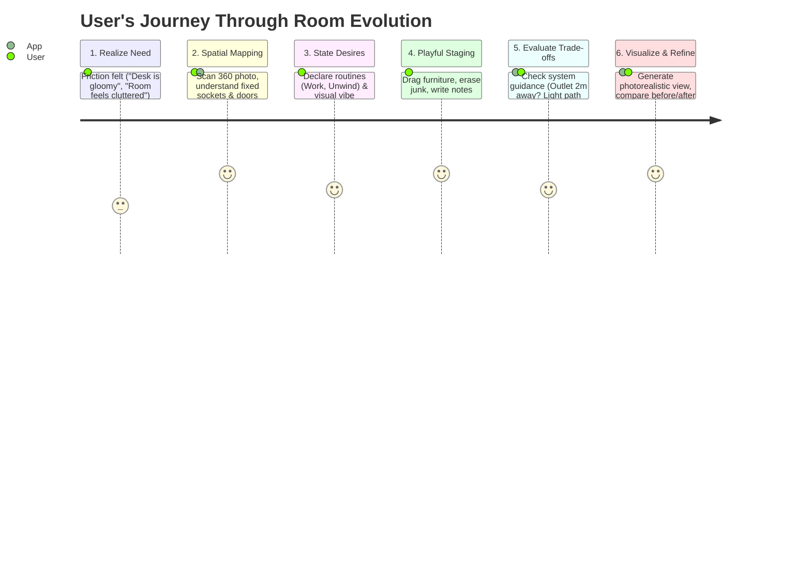

# Step 01: Scope, Mental Model & Design Principles

[← Back to Overview](./00_overview.md) | [Next: Information Architecture →](./02_information_architecture.md)

---

## 1. Target Audience & Problem Context

* **Primary Users**: Individuals who have primary control over a limited personal living space (compact bedrooms, single-room studio apartments, university dorm rooms, personal rented rooms in shared flats).
* **The Core Problem**: People have multifaceted lifestyle needs (work, sleep, exercise, relax, hobbies) crammed into a tight physical space. Discovering what works currently requires **physical trial-and-error** (hauling heavy desks, shifting beds, realizing sockets don't reach or doors won't open).
* **Emotional State**: Frustration with physical effort, anxiety over making a bad spatial commitment, feeling constrained by fixed architectural elements (windows, doors, switchboards).

---

## 2. Scope Boundaries

| In Scope ✅ | Out of Scope ❌ |
| :--- | :--- |
| Personal, compact living spaces (1 room / zones) | Whole-house structural or architectural remodeling |
| Spatial layout exploration, arrangement & repurposing | Commercial interior design CAD specifications |
| 360° photo-based sticker manipulation & AI restyling | Precise millimeter dimension drafting / tape measurement tools |
| Contextual trade-off & conflict guidance (outlets, light, flow) | Standalone decluttering, storage organization or Marie Kondo flows |
| Continuous live layered editing after visualization | Dead-end flattened static render screens |
| Guardrailed architectural anchor tags (windows, walls) | Freehand generative brush painting (causes messy hallucinations) |
| Ambient style infusion via moodboards & keywords | Pure furniture shopping / e-commerce catalog checkout *(Deferred to Post-MVP; see [08_future_monetization_and_product_link_ingestion.md](./08_future_monetization_and_product_link_ingestion.md))* |
| Full-bleed photographic 360 immersion | Mini-floorplan radars or compass overlays (unnecessary visual clutter) |

---

## 3. The User Mental Model Journey

1. **Trigger / Friction**: *"My room feels cramped"*, *"I need a proper work-from-home spot"*, *"I can't reach the power point from my bed"*.
2. **Current Room Reality**: *"Where are my fixed constraints? Windows, doors, power sockets, radiators, walkways?"*
3. **Intent & Feeling**: *"I want it to feel calm, focused, and open."*
4. **Imagining Possibilities**: *"What if I move my desk near the window? Can I work with what I have before buying new items?"*
5. **Evaluating Trade-offs**: *"Will this block my closet door? Will sunlight cause screen glare? Do I need an extension cord?"*
6. **Testing Visually**: Generate realistic view without breaking a sweat moving furniture.
7. **Living With It**: Save as a version/setup, refine iteratively over time.

---

## 4. Fundamental Design Principles

1. **Agency Over Automation (Guidance, Not Dictation)**:
   * The AI must **never** say: *"Here is the only right way to arrange your room."*
   * The AI says: *"Here are trade-offs to keep in mind: moving your desk here gives you direct sunlight, but the nearest socket is 2.5m away."*
2. **Tactile Simplicity (Zero UI Clutter & No Numeric Inputs)**:
   * No 3D gimbal axes, rotational Euler angles, or millimeter inputs.
   * Moving a piece of furniture feels like moving a **sticker on a photo**.
   * Dimensional intelligence runs entirely under the hood: no scale integers, metric dimensions, or bounding boxes clutter the user's screen. A whisper-quiet architectural perspective grid appears only while dragging, grounding the motion without numbers.
3. **Continuous Layered Agency (Zero Dead-End Screens)**:
   * Hitting "Done / Visualize" does **not** bake the room into a static flattened raster.
   * The canvas remains 100% live and interactive: furniture stickers remain movable layers resting on the synthesized clean base room. The user simply keeps exploring and stops when they love what they see.
4. **Architectural Guardrails Over Freehand Brushing**:
   * Freehand finger-painting brush masks on mobile screens leads to messy, jagged blobs and perspective hallucinations.
   * Instead, architectural accents (e.g. sheer curtains, wood blinds) anchor directly to detected 3D structural elements (windows, doors, walls) via clean tags, ensuring photorealistic perspective and lighting fidelity.
5. **60% Confidence Rule on Heuristics**:
   * Machine vision and spatial depth are estimations, not laser LIDAR guarantees.
   * Frame feedback as constructive observations rather than strict blockers.
6. **Preserve Personal Identity & Controlled Restyling**:
   * Global moodboards set room ambiance (lighting temperature, wall paint warmth).
   * Existing furniture items retain their authentic geometry and materials unless the user explicitly attaches a restyling design note (e.g., *"Make this desk walnut wood"*).
