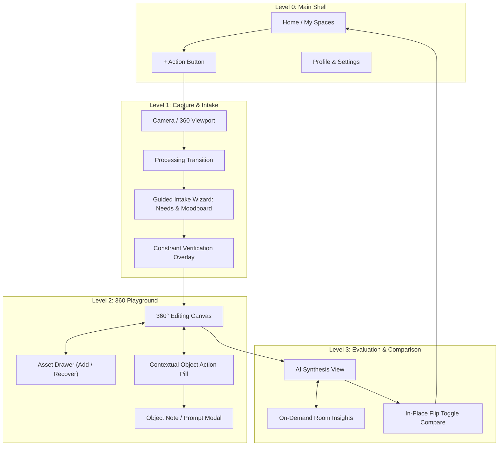

# Step 02: Information Architecture & Data Hierarchy

[← Back to Step 01](./01_scope_and_mental_model.md) | [Back to Overview](./00_overview.md) | [Next: Screen Specifications →](./03_ui_and_screen_specs.md)

---

## 1. High-Level App Map



---

## 2. Core Data Entities & Schema

Below is the clean data model that drives the application state:

```typescript
// Core Space / Project
interface RoomProject {
  id: string;
  name: string;                   // e.g. "Bedroom Studio", "North Loft"
  createdAt: string;
  updatedAt: string;
  originalScanUrl: string;        // Equirectangular 360 image URL
  baseRoomUrl: string;            // Clean inpainted empty room panorama
  ceilingHeight: 'low' | 'standard' | 'high' | 'custom';
  ceilingHeightCm?: number;       // Calibrated metric anchor (e.g. 265 cm)
  stackFactorMultiplier?: number; // Human bodily fallback ratio (e.g. 1.6x)
  
  // Architectural fixed points mapped by AI
  constraints: RoomConstraint[];
  
  // Segmented interactive objects
  assets: RoomAsset[];
  
  // User onboarding context
  preferences: UserPreferences;
  
  // Saved versions / experimental setups
  savedViews: SavedView[];
}

// Fixed Architectural Constraints (Cannot be dragged)
interface RoomConstraint {
  id: string;
  type: 'window' | 'door' | 'power_socket' | 'switchboard' | 'radiator';
  yaw: number;                    // Horizontal angle (-180 to +180 deg)
  pitch: number;                  // Vertical angle (-90 to +90 deg)
  label: string;
  metadata?: {
    doorSwingDirection?: 'inward' | 'outward';
    naturalLightQuality?: 'morning' | 'afternoon' | 'indirect';
  };
}

// Draggable Furniture / Decor Sticker Asset
interface RoomAsset {
  id: string;
  name: string;                   // e.g., "Work Desk", "Ergonomic Chair", "Monstera Plant"
  category: 'furniture' | 'decor' | 'lighting' | 'rug';
  plane: 'floor' | 'wall' | 'surface' | 'ceiling'; // Physics & geometric scaling plane
  activePngUrl: string;           // Transparent alpha cutout currently displayed
  contactShadowUrl?: string;      // Baked ambient floor contact shadow polygon
  yaw: number;                    // Position in 360 sphere
  pitch: number;
  
  // Invisible Intrinsic Scale Model (Never shown as numbers to user)
  intrinsicScaleCm: {
    width: number;                // e.g. 120 (Desk width footprint)
    depth: number;                // e.g. 60
    height: number;               // e.g. 75
  };
  
  renderScale: number;            // Projected screen scale mathematically computed: (Scale × f) / depthZ
  depthZ: number;                 // Metric distance along floor plane (determines z-index sorting)
  isOriginal: boolean;            // Scanned from room vs added from library
  isErased: boolean;              // Hidden by user
  notes: string[];                // User design prompt/comments attached to this item
  
  // Asset Variants Model (Serves as Multi-View References for AI Generations)
  variants: AssetVariant[];
  activeVariantId: string;
  
  // Spatial Intent & Suggestive Orientation Pills (Replaces Manual Rotation)
  calculatedPrompt?: string;      // e.g., "Position desk under east window" (editable by user)
  suggestivePills: SuggestivePill[]; // e.g. [ { label: "Facing Window", rationale: "Best Natural Light" }, ... ]
  selectedPillId?: string;
}

// Multi-View & Material Asset Variant
interface AssetVariant {
  id: string;
  type: 'scanned_original' | 'material_restyled' | 'view_angle';
  title: string;                  // e.g., "Scanned Original", "Dark Walnut Finish", "Isometric Angle"
  pngAlphaUrl: string;            // Feathered transparent PNG
  viewAngleDeg: number;           // 0 (front), 45 (isometric), 90 (side)
  materialPrompt?: string;        // "matte black steel legs with dark walnut wood top"
}

// Architectural Suggestive Orientation Pill
interface SuggestivePill {
  id: string;
  label: string;                  // e.g., "Facing Window", "Flush to North Wall", "45° Corner Angle"
  rationale: string;              // e.g., "Best Natural Light", "Preserves Walkway", "Cozy Reading"
  targetYawOffsetDeg: number;     // Orientation angle relative to room wall
}

// User Lifestyle Context
interface UserPreferences {
  frictionPoints: string;         // e.g., "Desk is dark, bed feels squeezed against wall"
  activityKeywords: string[];     // ["Focus / Work", "Rest", "Reading", "Yoga"]
  moodboardStyle?: string;        // "Warm Minimalist", "Japandi", "Moody Modern"
  referenceImages: string[];      // URLs from camera roll or Pinterest
}

// Conflict / Guidance Observation
interface SpatialTradeoff {
  id: string;
  severity: 'friction' | 'neutral' | 'positive'; // Internal only (do not show badge/color in UI)
  icon: string;
  title: string;
  description: string;
  relatedAssetId?: string;
  relatedConstraintId?: string;
}

// Saved Layout Variation / Activity Mode
interface SavedView {
  id: string;
  title: string;                  // e.g., "Focused Window View"
  activityMode: string;           // e.g., "Work Setup", "Evening Unwind", "Weekend Open"
  synthesizedImageUrl: string;    // Final photorealistic AI render
  assetConfiguration: RoomAsset[];
  tradeoffs: SpatialTradeoff[];
  createdAt: string;
}
```

---

## 3. The 5-Tier Layer Stack & Z-Depth Architecture

The interactive canvas operates on a deterministic, non-destructive 5-tier layer stack:

```
┌────────────────────────────────────────────────────────────────────────┐
│                        THE 5-TIER LAYER STACK                          │
├────────────────────────────────────────────────────────────────────────┤
│  [Tier 5: Contextual Tag UI] ── Suggestive Pills & Editable Prompt     │
│  [Tier 4: In-Flight Grid]    ── Transient Faint Floor Grid (Drag Only) │
│  [Tier 3: Surface Assets]    ── Tabletop items (snapped to parent Y)   │
│  [Tier 2: Floor Assets]      ── Transparent PNGs + Shadows (Z-sorted)  │
│  [Tier 1: Constant Base Room]── Inpainted Clean Room + Immovable Hooks │
└────────────────────────────────────────────────────────────────────────┘
```

1. **Tier 1: Constant Base Room Backdrop ($Z = \infty$)**:
   * A continuous, photorealistic empty room panorama synthesized by removing all chunky furniture.
   * **Immovable Architectural Reality**: Doors, windows, power switchboards, radiators, and floor skirting stay permanently baked into this layer. It is immutable during user staging.
2. **Tier 2: Draggable Floor Asset Layers ($Y = 0$)**:
   * Transparent PNG cutouts with feathered edges (1–2px) and baked ambient floor contact shadow polygons.
   * **Mathematical Depth Sorting**: Layers are sorted in real time by metric distance $Z_{depth}$. Foreground objects cleanly occlude background objects ($Z\text{-index} \propto 1/Z_{depth}$).
   * **Automatic Perspective Foreshortening**: As depth increases, rendered scale decreases ($\text{Size} \propto 1/Z_{depth}$).
3. **Tier 3: Surface Asset Snap Layers ($Y = Y_{parent}$)**:
   * Objects classified as `surface` (lamps, monitors, books) snap their base elevation to their parent furniture item's top plane ($Y = 75\text{cm}$) and move in tandem.
4. **Tier 4: Transient Perspective Floor Grid**:
   * Whisper-quiet graphite perspective grid rendered across the floor plane strictly while holding and dragging an item. Dissolves within 180ms on release.
5. **Tier 5: Floating Intent Tags & Suggestive Orientation Pills**:
   * Anchored directly above dropped items. Displays zero numeric dimensions; presents 2–3 contextual orientation pills with design rationale.

## 4. Screen Navigation Transitions

1. **Modal Ingestion**: Starting a scan opens a modal flow (`/scan` → `/scan/preferences` → `/scan/review`) which slides in from the bottom of the Home screen.
2. **Smooth Crossfade to Canvas**: When finishing the constraint review, the camera view crossfades into the interactive 360° sphere canvas (`/canvas/:projectId`).
3. **Non-destructive Draft State**: All sticker drags, deletions, and notes are stored in a draft state until the user taps **"Done / Generate"**, allowing infinite undos and redos.
4. **Fluid In-Place Comparison**: Comparison between original and redesign can be toggled smoothly via an instant flip button or hold-to-peek gesture directly on the 360 canvas.
