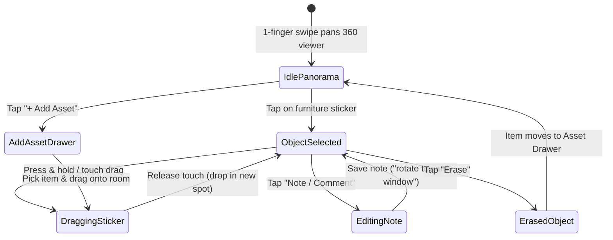

# Step 04: Canvas Interaction Model & Gestures

[← Back to Step 03](./03_ui_and_screen_specs.md) | [Back to Overview](./00_overview.md) | [Next: AI Vision Pipeline →](./05_ai_vision_pipeline.md)

---

## 1. The Core Interaction Paradigm: 2.5D Stickers on a 360° Sphere

Traditional 3D room apps fail mobile users because they require 3-axis rotation gizmos (pitch, roll, yaw), XYZ dimension boxes, and complex camera collision.

This application replaces that cognitive burden with a **tactile photo-sticker paradigm**:
1. The room background is rendered as an equirectangular 360° sphere.
2. The extracted furniture items are **transparent PNG cutout stickers** placed at spherical coordinates $( \theta, \phi )$ (Yaw & Pitch) and grounded to the Manhattan 3D floor plane.
3. The underlying image beneath every original item has already been **inpainted clean** into a constant, immutable base room layer.
4. When a user moves a sticker, the clean floor/wall behind it is naturally visible, with zero visual tearing!
5. **Continuous Layered Agency**: Hitting "Done / Visualize" does not lock the screen into a static render. It simply synthesizes high-res relit variants for the stickers and updates the base room atmosphere; the layers remain 100% interactive so the user can continue moving items and stop whenever they like what they see.
6. **Guardrailed Architectural Tags**: Accents like curtains or wall art are applied by tapping fixed structural anchors (`🪟 Window`, `🧱 Wall`), completely eliminating the mess and distortion of freehand brush masks.

```
[ Contextual Note Cards & Suggestive Pills ] <-- Direction, notes & trade-offs
                      ▲
                      │
[ Draggable Transparent PNG Asset Layers ]   <-- Interactive items (with baked shadows)
                      ▲
                      │
[ Constant Inpainted Base 360 Room Layer ]   <-- Clean background + immovable hooks
```

---

## 2. Gesture Hierarchy & Touch States



### A. Pan & Explore (Idle State)
* **Single Finger Drag**: Smoothly rotates the panoramic viewpoint around the room center.
* **Pinch to Zoom**: Adjusts field-of-view (FOV) from 50° to 100° for wide angles or close inspections.
* **Double Tap**: Resets viewpoint to horizon center.

### B. Touch Gestures & Sticker Activation
* **Single Tap on Sticker (Inspect & Information State)**:
  * Single tap **does NOT move** the item. This prevents accidental shifts while panning the 360 viewer.
  * Tapping opens the **Sticker Information Tag & Options Menu** anchored directly above the object.
* **Hold-then-Drag (Repositioning Gesture)**:
  * **Press & Hold (~200ms)** with a subtle tactile haptic pulse lifts the item into dragging mode.
  * The object sticker scales slightly with an enlarged dynamic drop shadow, indicating it is### C. Sticker Information Tag & Options Menu Breakdown

When a user taps an object (or when an item is dropped), the floating tag provides a clean, self-contained interaction surface:

```
┌────────────────────────────────────────────────────────────────────────┐
│  Work Desk                                          [ Floor Object ]   │
│  ────────────────────────────────────────────────────────────────────  │
│  Intent: "Position desk under east window"                        ✏️   │
│                                                                        │
│  Suggestive Orientation: (Tap to align)                                │
│  [ 🪟 Facing Window • Best Light ]  [ 🧱 Flush to Wall • Clean Flow ] │
│                                                                        │
│  Note:   "Make it dark walnut with matte black legs"                   │
│  ────────────────────────────────────────────────────────────────────  │
│  [ ✋ Move ]   [ 🎨 Variants (2) ]   [ 💬 Note ]   [ 🗑️ Erase ]        │
└────────────────────────────────────────────────────────────────────────┘
```

#### 1. What Goes in the Sticker Information Tag:
* **Object Identity & Plane Badge**: e.g., `Work Desk` • `[ Floor Object ]` or `Vanity Mirror` • `[ Wall Object ]`.
* **Calculated Spatial Intent Prompt**: Natural language description calculated from the object's current room coordinates (e.g., *"Position desk under east window"*). Tapping the pencil icon (`✏️`) lets the user directly edit this prompt.
* **Suggestive Orientation Pills with Rationale (Zero Manual Rotation)**: Instead of fiddly 3D rotation gizmos, the system evaluates room geometry and surfaces 2–3 smart contextual pills (e.g., `[ Facing Window • Best Natural Light ]` | `[ Flush to Wall • Clean Perimeter ]`).
* **Attached Note & Variant Selector**: Displays custom styling notes and lets users toggle between generated material variants (e.g., *Original* vs *Dark Walnut*).

#### 2. What Goes in the Sticker Options Menu:
* `[ ✋ Move ]`: Unlocks manual drag mode if the user prefers tapping over holding.
* `[ 🎨 Variants ]`: Opens thumbnail selector of visual variants (original scan, restyled finishes, multi-angle views).
* `[ 💬 Note ]`: Expands text input to dictate/type a design or material instruction.
* `[ 🗑️ Erase ]`: Triggers smooth puff-out animation and transfers the item to the Asset Drawer under *"Hidden Items"*.
* **Auto-Collapse**: Tapping anywhere outside the tag collapses it into a subtle `💬` pin above the item to keep the 360 viewport completely clean.

---

### D. Spatial Plane Taxonomy, The Constant Base Layer & Z-Depth Physics

To ensure realistic physical placement and feed powerful geometric priors to the AI generative model, the canvas is built upon a **strictly non-destructive multi-layer system**:

```
┌────────────────────────────────────────────────────────────────────────┐
│                  LAYER STACK & Z-DEPTH SORTING SYSTEM                  │
│                                                                        │
│  [Tier 5: Contextual Tag UI] ── Suggestive Pills & Editable Prompt     │
│  [Tier 4: In-Flight Grid]    ── Transient Faint Floor Grid (Drag Only) │
│  [Tier 3: Surface Assets]    ── Tabletop items (snapped to parent Y)   │
│  [Tier 2: Floor Assets]      ── Transparent Cutouts + Shadows (Z-depth)│
│  [Tier 1: Constant Base Room]── Inpainted Clean Room + Immovable Hooks │
└────────────────────────────────────────────────────────────────────────┘
```

#### 1. The Constant Base Room Layer ($Z = \infty$)
* **Immutable Foundation**: All movable chunky furniture is removed upfront to synthesize an empty, photorealistic base room.
* **Immovable Architectural Hooks**: Doors, windows, power switchboards/sockets, radiators, and floor skirting boards remain **permanently baked** into this base layer. This guarantees that the room's physical layout and lighting anchors never drift or hallucinate between edits.
* **Manhattan 3D Bounding Box Anchor**: Because the base room is completely empty, room corners, floor-wall baseboards, and ceiling perimeters are fully unobstructed—allowing the AI to construct the 3D room hull with 10× greater geometric accuracy than from raw cluttered photos.

#### 2. Transparent Asset Layers with Baked Contact Shadows
* **Feathered Alpha Cutouts**: Every furniture item lives as an independent transparent PNG layer with subtle edge feathering (1–2px).
* **Baked Floor Contact Shadows**: Each transparent floor asset includes an **ambient floor contact shadow polygon** baked directly into its base alpha channel. When the sticker moves across the floor, its contact shadow moves in tandem, ensuring it always looks grounded rather than floating.
* **Multi-View & Material Asset Variants**:
  * Each asset can store multiple visual variants:
    1. *Scanned Original* (initial baseline cutout).
    2. *Restyled Material Variants* (e.g. walnut wood, matte black, bouclé fabric created from user notes).
    3. *Multi-Angle Views* (front, 3/4 isometric).
  * These variants serve as high-fidelity conditioning references for downstream diffusion view synthesis.

#### 3. Mathematical Z-Depth Sorting & Collision Prevention
* **Metric Z-Depth Calculation**: When an asset is placed on the floor plane ($Y = 0$), its touch ray maps to a 3D coordinate $(X, Z_{depth})$ in the Manhattan room hull.
* **Strict Depth Sorting ($Z$-index)**:
  $$\text{Canvas Layer } Z\text{-index} = \frac{1}{Z_{depth}}$$
  Items deeper in the room (larger $Z_{depth}$) render behind closer items with mathematical certainty. Accidental visual overlap clashes are impossible.
* **Perspective Foreshortening**: Sticker scale is dynamically computed:
  $$\text{Rendered Pixel Size} = \frac{\text{Intrinsic Metric Footprint (cm)} \times \text{focal\_length}}{Z_{depth}}$$
  Pushing an object deeper naturally scales it down; pulling forward enlarges it. No pinch-zoom or scale guessing required.

#### 4. Plane Taxonomy & Physics Rules

| Plane Category | Item Examples | Canvas Physics & Motion Rules | AI Generative Guidance Benefit |
| :--- | :--- | :--- | :--- |
| **🪑 Floor Objects** | Beds, desks, chairs, sofas, rugs, nightstands, floor lamps | **Grounded to 3D floor horizon plane ($Y = 0$).** Cannot float into the air. Motion is locked to floor plane rays. Perspective scaling is mathematically computed based on $Z_{depth}$. Projects dynamic floor footprint oval + baked contact shadow. | Feeds ControlNet ground contact shadows and room depth gradient so legs rest naturally on floorboards without scale hallucinations (no dollhouse effect). |
| **🖼️ Wall Objects** | Mirrors, wall art, posters, hanging shelves, mounted TVs, wall clocks | **Grounded to vertical wall planes ($X = \pm W$ or $Z = \pm D$).** Cannot drop onto the floor; glides strictly across vertical wall surfaces. Foreshortens and scales relative to wall plane distance. | Feeds vertical wall normal maps so frames hang flush against drywall with realistic wall drop-shadows. |
| **💻 Surface Objects** | Table lamps, monitors, books, small potted desk plants | **Snapped to parent horizontal bounding surfaces ($Y = Y_{parent}$).** Snaps to tops of desks, nightstands, or shelves ($Y = 75\text{cm}$). Inherits parent motion when parent furniture is moved. | Informs inpainting model of tabletop containment and micro-occlusions. |
| **💡 Ceiling Objects** | Pendant lamps, chandeliers, ceiling fans | **Anchored to ceiling plane ($Y = H_{ceiling}$).** Glides across ceiling coordinates. | Guides overhead lighting position and ray casting. |

---

### E. Hold & Drag (Repositioning Gestures & In-Flight Feedback)

* **Hold & Lift (200ms)**: Pressing and holding an object lifts it off the floor with a subtle tactile haptic pulse and an elevated dynamic shadow.
* **In-Flight Faint Architectural Perspective Grid**:
  * **Touch-Only Activation**: The moment drag begins, a **whisper-quiet, fine graphite/pencil-sketch perspective floor grid** appears across the room's floor plane.
  * **Visual Language**: Delicate receding perspective lines converging toward the room's horizon / vanishing points, visually demonstrating depth and ground alignment.
  * **Directional Floor Footprint**: Beneath the active sticker, a faint oval with a subtle arrow indicates front-facing orientation and tracks across the floor grid.
  * **Zero Clutter Guarantee**: The grid displays **zero numbers or coordinate labels**. The moment touch is released, the grid smoothly dissolves within 180ms.
* **Automatic Perspective Foreshortening**:
  * As the user drags the sticker toward the back wall (higher in 2D viewport), the engine recalculates depth $Z$ along the calibrated floor plane.
  * The sticker naturally and smoothly scales down in real time. The user never needs to manually pinch-to-scale.
* **Automatic Depth Sorting (z-index)**: Stickers positioned deeper in 3D room space automatically render behind foreground objects.
* **Edge Auto-Pan**: Dragging within 40px of the phone’s left or right edge smoothly auto-pans the 360 camera view.
* **In-Flight Silent Constraint Cues**: Distance threads to outlets (`🔌 2.1m`) or door clearance arcs appear only when approaching proximity thresholds, fading out on release.

---

### F. On-Drop Suggestive Orientation Pills (Zero Manual Rotation)
*(Replacing awkward 3D rotational gizmos with architectural intelligence)*

* **Why Manual Rotation is Eliminated**:
  * Mobile 3D rotation rings or two-finger twist gestures cause extreme friction and result in unnatural angles.
  * In physical rooms, furniture naturally aligns to architectural anchors (flush against walls, facing windows, tucked into workstations).
* **On-Drop Architectural Evaluation**:
  * When the user releases the sticker, the system evaluates surrounding geometry in the Manhattan 3D box:
    1. Proximity to nearest wall (flush snap angle).
    2. Natural daylight vector from windows (screen glare vs illumination).
    3. Doorway swing clearance arcs (keeping walk paths clear).
    4. Proximity to complementary furniture (e.g. chair near desk).
* **Suggestive Orientation Pills with Rationale**:
  * The floating tag presents 2–3 contextual pills with clear design reasons:
    * Drop near East Window $\rightarrow$ `[ 🪟 Facing Window • Best Natural Light ]` | `[ 🧱 Parallel to Wall • Compact Flow ]`
    * Drop in Corner $\rightarrow$ `[ 📐 45° Corner Angle • Cozy Reading ]` | `[ 🧱 Flush to Left Wall • Clean Perimeter ]`
    * Drop near Desk $\rightarrow$ `[ 💻 Tucked into Desk Workstation ]` | `[ 🔄 Facing Room Center ]`
* **One-Tap Execution**:
  * Tapping a pill instantly updates the asset's facing orientation, regenerates the calculated prompt, and binds that geometric prior into the generation payload.
* **Footprint Crowding Resolution**:
  * If a user accidentally drops a chair directly into a bed frame, the tag gently suggests: `[ Slide 30cm to Bedside ]` or `[ Tuck under Desk ]` rather than triggering jarring physics collisions.
* **Subtle Collapsed Note Pin**:
  * Once an option is chosen, the tag neatly collapses into a tiny `💬` indicator pin anchored above the object. Tapping the pin re-expands the card at any time.

### G. Object Erasure (Decluttering)
* Tapping `🗑️ Erase`:
  * Plays a quick fade-and-puff animation.
  * The sticker disappears, instantly revealing the clean inpainted room base.
  * The object is moved to the **Asset Drawer** under *"Hidden Items"*, so the user can easily restore it at any time with a single tap.

### H. Adding New Assets (Dual Placement Behavior)
* Tapping the bottom dock `+ Add Asset`:
  * Opens a lightweight bottom drawer categorized into:
    * 🛋️ *Room Originals* (any items previously erased)
    * 🪴 *Decor Presets* (potted monstera, floor lamp, full-length mirror, area rug)
    * 📷 *Custom Upload* (crop an image from your photo library or moodboard)
* **Placement Interaction Modes**:
  1. **Quick Tap**: Tapping any asset in the drawer immediately places it at the center of the current screen view, ready to be nudged.
  2. **Drag out of Drawer**: Touching and dragging an asset upwards out of the drawer automatically closes the drawer and attaches the object to the user's finger.
     * **Edge Panning**: Dragging near the screen's left/right border smoothly pans the 360 viewpoint around the room.
     * **Top Edge Cancel**: Dragging the asset to the extreme top edge of the screen cancels placement, discards the temporary sticker, and reopens the asset drawer.
  3. **Release to Place**: Lifting the finger drops the asset in place on the floor/wall.

### I. Layout Starters (One-Tap Springboards)
* Tapping `✨ Starters` in the floating bottom dock:
  * Reveals an Apple spatial-style horizontal pill carousel with 2–3 generated starter concepts based on their onboarding goals (e.g., *"Window Workstation"*, *"Open Floor"*).
  * **Tapping a Starter**: All furniture stickers glide smoothly with physics tweening into that layout.
  * **Creative Agency Retained**: The user is never locked in—they can immediately tweak, drag, or revert back to the original baseline.
