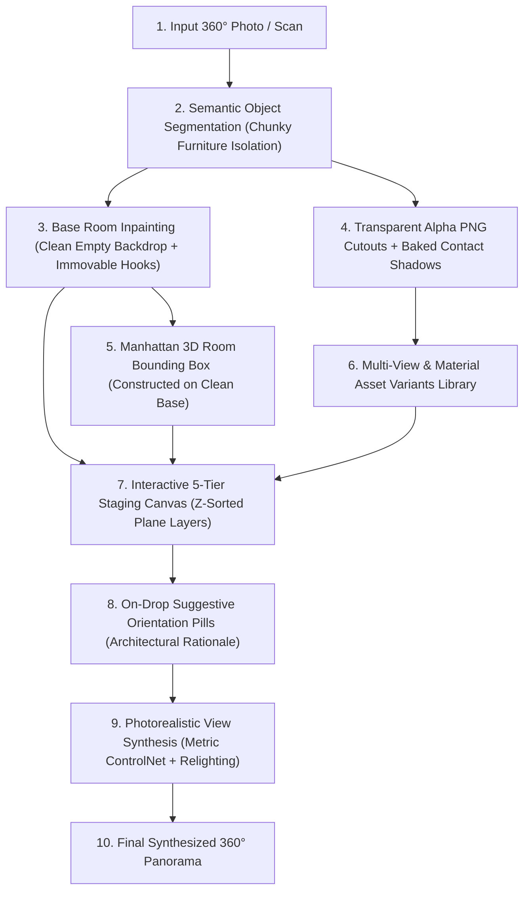

# Step 06: AI & Computer Vision Pipeline

[← Back to Step 05](./05_spatial_cue_and_constraint_framework.md) | [Back to Overview](./00_overview.md) | [Next: Tech Stack & MVP Roadmap →](./07_tech_stack_and_mvp_roadmap.md)

---

## 1. End-to-End Processing Architecture

---

## 2. Pipeline Sub-Systems Breakdown

### Phase A: Room Ingestion, Clean Base Synthesis & 3D Bounding Box

1. **Semantic Furniture Segmentation & Smart Clutter Dissolution**:
   * **Model**: SAM 2 (Segment Anything) or Gemini 2.5 Flash Multimodal Vision with coordinate bounding boxes.
   * **Target Isolation (Chunky Movable Furniture)**: Bed, desk, office chair, wardrobe, large rugs, floor lamps, major side-tables.
   * **Smart Clutter Dissolution**: Small everyday transient clutter (loose cables, laundry on chairs, mugs, shoes on the floor) is intentionally absorbed into the inpainting mask so that the base room is naturally decluttered and clean.
   * **Preservation of Immovable Architectural Hooks**: Doors, windows, power switchboards/sockets, wall heaters/radiators, and floor skirting boards are **never erased**—they stay permanently baked into the base room.

2. **Base Layer Inpainting (The Constant Empty Room Backdrop)**:
   * **Model**: LaMa Inpainting / Stable Diffusion Inpainting / Gemini Fill.
   * **Task**: Synthesize seamless, continuous floorboard textures, skirting boards, and drywall behind all removed chunky furniture.
   * **Role**: Stays **constant and immutable** as Tier 1 of the editing canvas ($Z = \infty$). Eliminates background tearing during staging.

3. **Manhattan 3D Bounding Box Calibration (Built on Clean Base)**:
   * **Why on the Clean Base?**: Detecting 3D vanishing points and wall-floor boundaries on raw photos is error-prone due to furniture occlusion. Because the base room is completely empty, the room corners, wall-floor lines, and ceiling junctions are 100% visible, yielding **10× greater geometric accuracy**.
   * **The Metric Anchor (Ceiling Height)**:
     * Grounded in ceiling height $H_{ceiling}$.
     * **Human "Stack Factor" Bodily Fallback**: If user skips numerical input:
       > *"How high does the ceiling feel compared to you?"*
       * `[ Can touch standing (~1.2× you) ]` • `[ Just out of reach (~1.4× you) ]` • `[ ~1.5 of me (~1.6× you) ]` • `[ High loft (~1.8×+ you) ]`
       * Formula: $H_{ceiling} = H_{person} \times \text{StackMultiplier}$.
   * **Metric Hull Generation**: Calibrates metric scale $s = H_{ceiling} / \Delta y_{pixels}$, constructing a Manhattan 3D room hull with real-world $(X, Y, Z)$ coordinates in centimeters.

4. **Transparent PNG Asset Extraction & Baked Contact Shadows**:
   * Extract RGB pixels for each segmented piece with subtle edge feathering (1–2px).
   * **Baked Ambient Contact Shadow**: An ambient floor contact shadow polygon is synthesized and baked into the base of each transparent alpha PNG. When moved across the floor, the shadow moves in tandem, ensuring items never look like floating stickers.

5. **Multi-View & Material Asset Variants Library**:
   * Each isolated asset is stored with an expandable variant schema:
     * `scanned_original`: Baseline cutout from the photo.
     * `material_variants`: Generative restyled versions (e.g. walnut wood, matte black, light oak) created when the user types design notes.
     * `angle_variants`: Multi-view perspectives (front, 3/4 isometric).
   * These variants serve as conditioning reference tokens for multi-view generation.

---

### Phase B: Spatial Intent & Suggestive Orientation Engine

#### 1. Real-time Suggestive Orientation Pills (On-Drop)
When the user releases a furniture sticker:
* **Zero Manual Rotation**: The user does not manipulate rotational gizmos.
* **Architectural Evaluation**: The engine calculates:
  1. Proximity to nearest perimeter wall (flush alignment).
  2. Window daylight vector (optimizing natural light, avoiding monitor glare).
  3. Door clearance arcs (ensuring swing path is unobstructed).
  4. Workstation pairing (e.g. aligning armchair with desk).
* **Suggestive Pills Generation**: Surfaces 2–3 contextual options with explicit design rationale:
  * Drop near Window $\rightarrow$ `[ 🪟 Facing Window • Best Natural Light ]` | `[ 🧱 Parallel to Wall • Compact Flow ]`
  * Drop in Corner $\rightarrow$ `[ 📐 45° Corner Angle • Cozy Reading ]` | `[ 🧱 Flush to Left Wall • Clean Perimeter ]`
  * Drop near Desk $\rightarrow$ `[ 💻 Tucked into Desk Workstation ]` | `[ 🔄 Facing Room Center ]`
* **Prompt Formulation**: Tapping a pill immediately writes the exact natural-language intent into the editable prompt and binds the geometric rotation vector to the generative payload.

#### 2. Spatial Trade-off & Conflict Reasoning
The guidance engine evaluates layout consequences quietly and conversationally:

| Constraint Type | Heuristic Rule | Generated Advisory Feedback |
| :--- | :--- | :--- |
| **Power Socket Proximity** | Distance between Desk/Workstation and nearest socket $> 2.0\text{m}$. | *“Desk is ~2.8m from the nearest outlet — an extension cord along the baseboard will keep cables tidy.”* |
| **Door Swing Clearance** | Placed item overlaps door arc clearance ($< 60\text{cm}$). | *“Nightstand is within 45cm of the door swing. Check that the door opens comfortably.”* |
| **Natural Daylight Angle** | Desk positioned facing or adjacent to window without screen glare angle. | *“Good natural daylight on the desk without direct afternoon glare on your screen.”* |
| **Circulation / Walkway** | Distance between bed edge and opposite wall/furniture $< 70\text{cm}$. | *“Walkway between bed and closet is narrow (~55cm). Good to verify you have comfortable room to walk.”* |

---

### Phase C: Photorealistic View Synthesis & Continuous Layered Staging

When the user taps **"Done / Visualize"**, the system blends the staged stickers and natural-language notes into a cohesive photographic scene without flattening the layers into a dead raster:

1. **Ambient Generation Transition (Visual Feedback)**:
   * To account for AI generation delay without leaving the user in a cold spinner, the viewport applies a **smooth blur gradient overlay** with an ambient shimmer.
   * In the background behind the blur, the 360 scene engages in a gentle, slow ambient pan.
   * A clean, non-intrusive status pill cycles through progressive phases:
     * *“Analyzing object positions...”* → *“Harmonizing lighting & cast shadows...”* → *“Synthesizing photorealistic space...”*
   * Once complete, the blur smoothly dissolves away with an elegant crossfade into the newly transformed room view.

2. **Continuous Layered Output (Non-Destructive Synthesis)**:
   * Rather than flattening the scene into an uneditable 2D raster image, the pipeline outputs:
     1. **Synthesized Base Room**: Clean empty floor & walls rendered with updated moodboard lighting, wall paint undertones, and floor textures.
     2. **High-Res Relit Asset Layers**: Updated transparent PNG variants for each furniture piece reflecting the new room lighting, contact shadows, and requested materials.
   * **Result**: The canvas **remains 100% interactive**. If the user drags a chair, the synthesized floor beneath is revealed. Staging is continuous; the user simply stops when they love what they see.

3. **Multi-Condition Synthesis & 3D Scale Conditioning**:
   * **Condition 1: Synthetic Metric Depth Map (ControlNet Depth)**:
     * Synthesized directly from the Manhattan 3D room hull and the 3D bounding volumes of all placed furniture pieces.
     * Provides continuous metric depth gradients $(Z_{depth})$, guaranteeing that objects placed further away render with mathematically exact perspective foreshortening and accurate inter-object occlusion.
   * **Condition 2: Volumetric Bounding Guidance (Anti-Hallucination Prior)**:
     * Constrains the generative inpainting model to the object's intrinsic physical bounds ($W \times D \times H$ in cm), eliminating dollhouse scale distortions.
   * **Condition 3: User Attached Notes & Enriched Spatial Prompt**:
     * Injects natural-language notes (e.g., *"Make desk dark walnut wood"*).
     * Enriches the latent conditioning prompt with metric relationships under the hood (e.g. *"desk placed flush against north wall at 3.2m depth"*).
   * **Condition 4: Style Infusion Scope (Ambiance vs. Furniture Identity)**:
     * **Global Room Ambiance**: The user's moodboard (e.g., *Japandi*, *Warm Minimalist*) controls lighting warmth, wall paint undertones, and overall atmosphere.
     * **Furniture Identity Preservation**: Existing furniture items retain their authentic scanned geometry and materials unless the user explicitly attaches a restyling design note.
   * **Condition 5: Multi-View & Material Asset Variant Tokens (Reference-Net / IP-Adapter)**:
     * Feeds high-resolution visual feature tokens from the active asset variant.
     * Guarantees identity consistency across different viewpoints and ensures generated items stay faithful to the user's selected materials.
   * **Condition 6: Guardrailed Architectural Anchor Tags**:
     * When accents like drapes or blinds are selected on a `🪟 Window` marker, the model conditions directly on the window's calibrated 3D polygon and daylight vector. This produces exact floor-length drapes with realistic light filtering, completely replacing messy freehand brush masks.

4. **Harmonization, Contact Shadows & Relighting**:
   * **Grounded Ambient Occlusion**: Knowing the exact 3D polygon contact patch where the furniture meets the floor plane ($Y = 0$), the pipeline renders soft, authentic contact drop-shadows.
   * **Directional Daylight Integration**: Casts subtle directional shadows consistent with the mapped window daylight vector.
   * Matches room color temperature and specular highlights so the synthesized furniture appears naturally photographed in the physical room.
