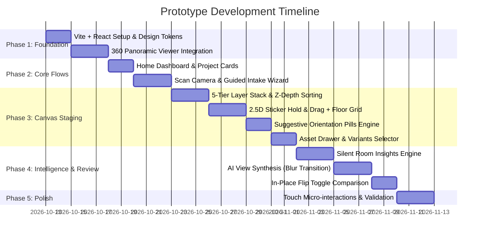

# Step 07: Tech Stack & MVP Implementation Roadmap

[← Back to Step 06](./06_ai_vision_pipeline.md) | [Back to Overview](./00_overview.md)

---

## 1. Prototype Tech Stack Recommendation

### Frontend Client (Phone-First Web Application)
* **Framework**: React 19 + TypeScript + Vite.
  * *Why*: Instant development feedback, zero mobile store publishing delay, runs smoothly on phone browsers via local network/URL, and easily wraps into Capacitor/PWA if native mobile packaging is desired later.
* **360 Panoramic Rendering**:
  * **Three.js** or **Photo Sphere Viewer**.
  * Lightweight equirectangular projection with gyro sensors, touch dragging, and HTML/SVG hotspot overlays.
* **Touch & Drag Engine**:
  * Pointer Events API / Framer Motion.
  * Handles mobile touch drag, physics drop animations, and z-index layer ordering.
* **Styling & UI Tokens**:
  * Modern Vanilla CSS / Tailwind with custom CSS variables.
  * Warm, tactile dark/neutral palette (inspired by high-fidelity wireframe `Screenshot 2026-09-30 132118.png`).
  * Glassmorphic floating navigation docks (`backdrop-filter: blur(16px)`).
  * Lucide Icons for ultra-clean iconography.

### Backend & AI Integration (Prototype Architecture)
* **API Service**: Lightweight Node/Express or FastAPI server.
* **AI Orchestration**:
  * Gemini 2.5 Flash / Gemini Pro API via official Google GenAI SDK for multimodal spatial analysis, constraint extraction, and trade-off feedback reasoning.
  * Inpainting & Image Synthesis mock/live pipeline (Stable Diffusion XL Inpainting or Gemini Image-to-Image).
* **Camera & Media Ingestion**:
  * Native mobile file input (`accept="image/*"` with camera/gallery intent) enabling direct photo capture from phone hardware or selection of existing 360 equirectangular panoramas.
* **Client-Side Persistence (IndexedDB)**:
  * Persistent offline storage for created spaces, uploaded photos, customized Activity Modes, and object notes so they remain saved across page refreshes and sessions.

---

## 2. MVP Scope Definition

| Capability | In MVP Prototype | Post-MVP / Production |
| :--- | :---: | :---: |
| **Home Dashboard** | ✅ Recent projects & saved views toggle | Cloud sync & user team accounts |
| **Room Ingestion** | ✅ Camera capture / 360 photo upload from gallery (authentic flow) | Real-time gyro auto-stitching camera |
| **Onboarding Intake** | ✅ Full-screen sequential wizard with ceiling height & human Stack Factor fallback | Audio voice conversation interview |
| **Constant Base Room** | ✅ Synthesized empty room with permanently baked architectural hooks | Real-time dynamic lighting simulation |
| **3D Calibration & Hull** | ✅ Manhattan 3D room hull built on clean base room via ceiling anchor | Continuous dynamic mesh reconstruction |
| **5-Tier Layer Stack** | ✅ Mathematical Z-depth sorting ($Z\text{-index} \propto 1/Z_{depth}$), baked contact shadows | Full 3D rigid-body collision engine |
| **Orientation Engine** | ✅ Zero manual rotation; smart suggestive orientation pills with design rationale | Freeform 3-axis rotation gizmos |
| **Asset Variants** | ✅ Multi-view and restyled material variants library per asset | Real-time 3D Gaussian splat generation |
| **360 Interactive Canvas** | ✅ Smooth 360 pan, direct touch sticker drag with edge auto-pan & top cancel | Multi-object bounding box group rotation |
| **Object Note Cards** | ✅ Contextual sticky note prompts collapsing into subtle note pins (`💬`) | Multi-user collaborative notes |
| **AI View Synthesis** | ✅ Synthetic metric depth conditioning (ControlNet), variant conditioning tokens | Real-time WebGL neural radiance field |
| **Spatial Guidance** | ✅ Silent on-demand observation sheet (no severity badges or alarmist tags) | Environmental acoustics & HVAC airflow simulation |
| **Comparison** | ✅ In-place flip toggle & hold-to-peek between original and redesign | Full AR walkthrough overlay in room |

---

## 3. Step-by-Step Development Phases

---

## 4. Verification & Testing Checklist

- [ ] **Mobile Viewport Test**: Verify touch pan, pinch-to-zoom, and safe area insets on mobile Safari and Chrome.
- [ ] **Scan & Intake Flow Test**:
  - Upload/select 360 photo from gallery.
  - Complete 4-step wizard (room name, ceiling height selection or "Stack Factor" bodily estimation fallback, friction, activity chips, moodboard).
  - Review detected constraints and click explicit *"Open Playground →"* button.
- [ ] **Clean Base Room & 3D Layer Test**:
  - Verify **constant base room backdrop** remains immutable while dragging furniture.
  - Verify **baked architectural hooks** (doors, windows, outlets) stay anchored.
  - Verify **in-flight faint architectural perspective grid** activates on touch and dissolves within 180ms.
  - Verify **strict zero-numbers rule**: no dimensions or scale integers shown to the user.
  - Verify **automatic perspective foreshortening**: sticker scales down naturally as dragged deeper along the floor plane.
  - Verify **mathematical Z-depth sorting**: foreground items naturally occlude background items without visual clashing.
- [ ] **Suggestive Orientation Pills Test**:
  - Drop an item near a window/wall/corner; verify 2–3 suggestive pills appear with clear rationale (e.g. `[ Facing Window • Best Natural Light ]`).
  - Verify tapping a pill instantly updates orientation without requiring manual 3D rotation gizmos.
- [ ] **Asset Variants Test**:
  - Verify switching between original cutout, material variants, and multi-angle views.
- [ ] **Synthesis & Continuous Staging Test**:
  - Tap "Done / Visualize"; verify ambient blur gradient overlay with slow pan shimmer.
  - Verify smooth crossfade into transformed room view.
  - Verify **continuous live layered staging**: furniture stickers remain movable layers resting on the synthesized clean base room (no dead-end screen).
  - Verify **architectural anchor tagging**: tapping window/wall markers applies accents (drapes, blinds) without freehand brush painting.
  - Tap `💡 Room Insights`; verify neutral observation sheet opens without alarmist warning tags.
- [ ] **Comparison Test**:
  - Test in-place flip toggle `[ Original ]` ↔ `[ Redesign ]`.
  - Test hold-to-peek gesture (press to view original, release to view redesign).
