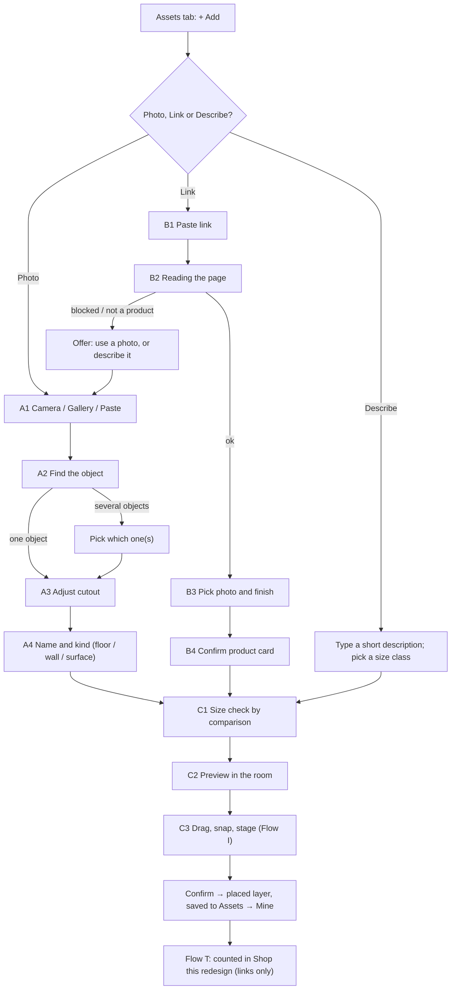

# Step 09: Additional User Flows (incl. Add Object from Image or Product Link)

[← Back to Step 08](./08_future_monetization_and_product_link_ingestion.md) | [Back to Overview](./00_overview.md)

---

## 0. How to read this doc

* **Already specced/built** flows (Home → Scan → Onboarding → Editor, hold-drag-confirm, library add) are only referenced, not repeated. See `PROTOTYPE.md` and Steps 02–04.
* Every flow below uses the same format: **Trigger → Steps → States/edge cases → Exit → Prototype (Wizard of Oz) note**.
* All flows obey the four principles in `PROTOTYPE.md`: agency over automation, no numbers on screen, no dead ends, less typing.
* Tags: `[BUILT]` exists in the prototype, `[PLANNED]` in the plan docs but not built, `[NEW]` identified in this doc.

### Flow index

| # | Flow | Tag |
|---|---|---|
| A | **Add object from an image** | NEW |
| B | **Add object from a product link** | NEW |
| C | Shared tail of A and B: *Review → Size check → Place* | NEW |
| D | First run and empty state | NEW |
| E | Resume / reopen a project | NEW |
| F | Capture: 360° room vs single-photo zone, including upload from gallery | BUILT (partial) |
| G | Scan problems and recovery | NEW |
| H | Verify detections (constraints, then movable objects) | BUILT |
| I | Move an object: hold, drag, snap, stage, Confirm / Discard | BUILT |
| J | Move variants: wall items, items on surfaces, blocked drops | NEW |
| K | Remove an object and restore it (Hidden items) | PLANNED |
| L | Restyle one object (note → variants) | PLANNED |
| M | Ask AI (scoped prompt bar) | BUILT (scripted) |
| N | Room Insights (on-demand trade-offs) | PLANNED |
| O | Refine mode (surface-only changes) | NEW (undefined in prototype) |
| P | Compare before/after and hold-to-peek | PLANNED |
| Q | Save a version / activity mode and switch between them | PLANNED |
| R | Undo, redo, reset | PLANNED |
| S | Share for feedback (flatmate, landlord, parent) | NEW |
| T | Shop this redesign (shopping list and export) | NEW (extends Step 08) |
| U | Edit project: rename, redo intake, re-scan after a real-world change | NEW |
| V | Duplicate, archive, delete a project | NEW |
| W | Errors, offline, permissions (cross-cutting) | NEW |

---

## A. Add object from an image `[NEW]`

**Job to be done:** *"I saw a chair/desk/lamp somewhere (a photo, a screenshot, my friend's flat, a shop shelf). Let me try that thing in my room."*

### Entry points
1. Editor → **Assets** tab → **`+ Add`** tile (first tile in the grid, always visible) → sheet with three options: `Photo`, `Link`, `Describe`.
2. Share-sheet / "Open in Kith" from the phone gallery or browser (image arrives pre-attached, skips step 1).
3. Onboarding step 1 mood board: long-press a reference image → `Use an object from this`.
4. Paste anywhere in the editor (clipboard holds an image) → toast `Add this image as an object?`.

### Steps

| # | Screen | What the user does | What the system does |
|---|---|---|---|
| A1 | **Source sheet** | Picks `Take photo`, `Choose from gallery`, or `Paste screenshot` | Opens camera / picker. Accepts JPG, PNG, HEIC, WebP. Max 12 MB, resized client-side |
| A2 | **Find the object** | Sees the image with one object softly outlined (auto-picked) | Runs object detection + segmentation. If it finds several objects, shows numbered outlines and asks `Which one?` |
| A3 | **Adjust the cutout** | Taps the outline to accept, or taps/lassos extra area to include or exclude | Refines mask. Shows live preview on a checkerboard + on a plain floor swatch |
| A4 | **Name and kind** | Confirms pre-filled name (`Walnut armchair`) and kind pill: `Floor`, `Wall`, `On a surface`, `Hanging` | Classifies plane. Name is editable, kind pills are the only required choice |
| A5 | → **Flow C** | Size check and placement | |

### States and edge cases
* **Multiple objects (sofa + coffee table + lamp):** numbered outlines. Multi-select allowed; each becomes its own asset, added in one batch.
* **Object cropped out of frame (half a chair):** warn `Part of this is cut off. We'll finish the shape`. Offer `Try another photo`. Do not block.
* **Cluttered or low-light photo:** show mask quality as a calm 3-state hint (`Clean`, `Rough edges`, `Hard to separate`). Rough → offer the refine step as default; Hard → suggest a clearer photo.
* **Photo of a whole room:** do not guess. Show `This looks like a room. Tap the one thing you want`.
* **Person or pet in the frame:** exclude from selectable objects by default (privacy and relevance).
* **Photo has only one angle (front):** mark the asset `single_view`. When the user rotates it in the room, the app generates the other angles in the background and shows the existing view until ready (see Variants, Flow L).
* **Not furniture (food, document, screen):** `This doesn't look like something for a room`, with `Add anyway`.
* **Duplicate:** same image hash already in the library → `You already added this. Use it again?`
* **Image from a screenshot with UI chrome (Instagram frame, price tag):** auto-crop UI; the price/brand text is never baked into the cutout.

### Exit
* Object is placed and staged (Flow C) and also saved to **Assets → Mine** so it can be reused in other rooms.

### Prototype (Wizard of Oz)
* Picking any photo shows a 1.5 s "finding the object" shimmer, then returns a pre-made cutout from a fixed set (armchair, floor lamp, bookshelf, plant) chosen by round-robin. A3 is a static screen with a believable outline. The real value to test is *whether users trust the cutout and understand where it lands*.

---

## B. Add object from a product link `[NEW]`

**Job to be done:** *"I'm looking at a desk on IKEA/Amazon/West Elm. Will it fit and look right in my room before I buy it?"*

Builds on Step 08 (post-MVP). Promoted here as a **design-ready flow**; the commercial layer (affiliate) is kept separable (see B-Commerce below).

### Entry points
1. Assets tab → `+ Add` → `Link`.
2. Share-sheet from a browser or shopping app → `Open in Kith` (URL arrives pre-filled).
3. Clipboard detection: when the Assets sheet opens and the clipboard holds a URL from a known retail domain → chip `Add the product from your clipboard?`.
4. Onboarding step 1 (Pinterest/board links) → a pin that contains a product → `Try in my room`.

### Steps

| # | Screen | What the user does | What the system does |
|---|---|---|---|
| B1 | **Paste link** | Pastes or shares a URL. One field, one `Add` button. Supported shops listed as small text (`IKEA, Amazon, Wayfair, West Elm, Pepperfry, Urban Ladder, Etsy, any shop`) | Validates URL, shows skeleton card immediately |
| B2 | **Reading the page** | Waits ~3–8 s. Progress phrases: `Opening the page…` → `Finding the product photos…` → `Reading the size…` | Fetches page server-side (never in the client), extracts title, price, currency, brand, images, variants (colour/finish), dimensions, category (see pipeline below) |
| B3 | **Pick the photo and finish** | Swipes a carousel of the product's images. Photos on plain/white background are marked `Best for placing`. Colour/finish pills (`Oak`, `Black`) switch images | Pre-selects the cleanest "hero" shot. Lifestyle shots are usable but segmented (Flow A, steps A2–A3) |
| B4 | **Confirm product card** | Sees a card: image, name, shop, price, `Size found` or `Size needed` state | Dimensions auto-filled when found (hidden as numbers, see Flow C) |
| B5 | → **Flow C** | Size check and placement | |

### Extraction pipeline (what B2 does)
1. **Resolve:** follow redirects and short links (`amzn.to`, `ikea.com/in/...`), strip tracking params, canonicalise.
2. **Structured data first:** JSON-LD `Product`, OpenGraph, `microdata` → title, price, images, variants, sometimes dimensions.
3. **Spec table parse:** find "Dimensions", "Size", "W × D × H", "Package size" (ignore package size, prefer assembled). Regex first, LLM fallback for free text. Normalise inch/cm/mm.
4. **Image choice:** rank images by plain background, single object, full frame, 3/4 angle. Run background removal (BiRefNet / SAM 2) on the winner.
5. **Category and plane:** classify (`desk`, `lamp`, `rug`, `wall art`) and map to `floor | wall | surface | ceiling`.
6. **Confidence per field:** `{title, images, dimensions, plane}` each get `high | medium | low`. Anything `low` becomes a question in Flow C rather than a silent guess.

### States and edge cases
* **Page is login-walled, bot-blocked, or JS-only:** `We couldn't open this page`. Offer: `Upload a photo of it instead` (→ Flow A with the link kept as source) and `Describe it` (→ manual).
* **Not a product page (search results, category, blog list):** `This looks like a list. Open one product and share that link`.
* **Several products on a page (bundle, "shop the look"):** show a picker of detected items; multi-select allowed.
* **Variants (sizes S/M/L):** size pills appear in B3. Chosen size drives dimensions. If the page doesn't expose per-variant sizes, ask in Flow C.
* **Out of stock / discontinued:** still addable; show a small `Not available` note. Flagged again in the shopping list (Flow T).
* **Price missing or in another currency:** show as found; convert only on the shopping list.
* **Dimensions are for the package, not the product:** detect (`Package`, `Box`, `Carton`) and discard; ask in Flow C.
* **Region redirect (IKEA IN → US):** keep the user's region page, show the shop domain on the card.
* **Duplicate link:** open existing asset.
* **Unsafe URL (non-http, file://, internal IPs):** blocked server-side, generic error. Fetcher is SSRF-hardened.
* **Slow page (> 15 s):** `This is taking a while` with `Keep waiting` / `Use a photo instead`. Request continues in background and surfaces as a toast in the editor.

### B-Commerce (separable layer, Step 08)
* Source URL, price and shop are stored on the asset (`source.url`, `source.priceMinor`, `source.currency`).
* Affiliate wrapping happens only at **outbound click time** in Flow T, never at ingestion.
* Disclosure line near the buy action: `Kith may earn a commission`.
* No product is ever ranked or inserted by Kith in the Add flow. Agency over automation.

### Legal and trust notes
* Product photos belong to the shop. Use them **only inside the user's private room**, never in public galleries or shared links without a visible `Image from <shop>` attribution (see Flow S).
* Respect `robots.txt` and site terms where applicable; prefer official feeds/APIs (IKEA, Amazon PA-API, Shopify storefront) over scraping when available.
* Fetch server-side so user IP and clipboard content are not exposed to the shop; do not store full HTML, only extracted fields.

### Prototype (Wizard of Oz)
* Any pasted URL resolves to one of 3–4 scripted products (desk, armchair, floor lamp, rug), chosen by keywords in the URL (`desk`, `chair`, `lamp`, `rug`) or by round-robin. Show real-looking loading phases (~4 s). Include one scripted failure path (`couldn't open this page`) triggered by a URL containing `fail`, so the error flow can be tested.

---

## C. Shared tail: Review, Size check, Place `[NEW]`

Used by both A and B (and by manual `Describe`).

### C1 · Size check (honours "no numbers on screen")
The system already knows or estimates dimensions. The user is **never shown or asked for numbers**; they confirm size by comparison.

| Situation | UI |
|---|---|
| **Size known (product page)** | Silent. A small `✓ True to size` chip on the preview |
| **Size estimated from a photo** | Preview shown next to a familiar reference already in the room (e.g. beside the user's bed or door). Pills: `Looks right` · `A bit smaller` · `A bit bigger`. Each tap nudges ±10 % and re-renders |
| **Size unknown** | Same as above, plus a one-question prompt: `Is this closer to your chair, your desk or your wardrobe?` (picks a size class) |
| **Real number known by the user (optional)** | `I know the exact size` link reveals W/D/H fields. This is the only place numbers appear, opt-in, collapsed by default |

* Always show a thin note: `Estimated from the photo` or `From the product page` so trust is calibrated.
* Scaled size is clamped to sane category ranges (a "desk" can't be 30 cm wide).

### C2 · Preview in the room
* The cutout appears **floating at the centre of the current view** with its soft floor footprint, already scaled for that distance.
* Header chip: `Not placed yet · drag to place`.
* Buttons: `Place here`, `Try another photo` (B only), `Cancel`.
* If the object is `wall` or `surface` kind, a one-line hint appears: `Drag onto a wall` / `Drag onto a table`.

### C3 · Place and stage
* Drag from the preview uses the standard Flow I behaviours (snap, scale with distance, edge pan, top-edge cancel).
* On release the object enters **staging** as a bounding box, like moved furniture, with a `New` marker (so users can tell added vs moved items on the Confirm summary).
* Suggestive orientation pills appear (`Facing window`, `Flush to wall`).
* **Confirm** generates the placed layer (scripted in the prototype).

### C4 · After placing
* Toast with `Undo` and `Edit` (opens Flow L).
* Object is saved to **Assets → Mine** with its source (`photo`, `link`) and appears there with a small source badge (image icon or shop favicon).
* If the object came from a link, a `🛍` chip is added to the tag so Flow T can include it.

### Data model additions (extends `RoomAsset` in Step 02 and `AssetItem` in `src/editor/AssetsDrawer.tsx`)

```typescript
type AssetSource =
  | { kind: 'scanned' }                                  // came from the room scan
  | { kind: 'library'; libraryId: string }               // built-in decor preset
  | { kind: 'photo';   imageUrl: string; capturedAt: string }
  | { kind: 'link';    url: string; shop: string; productTitle: string;
      priceMinor?: number; currency?: string; sku?: string;
      variantLabel?: string; fetchedAt: string }
  | { kind: 'described'; text: string };                 // manual, no image

interface AddedAsset extends RoomAsset {
  source: AssetSource;
  cutoutQuality: 'clean' | 'rough' | 'hard';
  sizeProvenance: 'product_page' | 'estimated_from_photo' | 'user_confirmed' | 'class_default';
  sizeConfidence: 'high' | 'medium' | 'low';
  viewCoverage: 'single_view' | 'multi_view';           // drives background angle generation
  plane: 'floor' | 'wall' | 'surface' | 'ceiling';
  mineSavedAt?: string;                                   // shows in Assets → Mine
}
```

### Flow diagram



### Open questions for A, B and C
1. Should `Add` live as a tile in the grid or as a persistent `+` in the dock? (Recommendation: tile in the grid, keeps the dock uncluttered.)
2. Do we show the shop's name and price on the sticker tag in the editor? (Recommendation: only inside the tag's expanded state, never on the photo.)
3. How far do we go with `Describe` (no image)? (Recommendation: ship it as the guaranteed fallback so no flow dead-ends.)
4. Single-view objects: render a flat-front sticker at all angles, or hold placement until the extra angles are generated? (Recommendation: show it immediately and upgrade silently.)

---

## D. First run and empty state `[NEW]`

**Trigger:** first launch, or `?empty` library.

1. Home shows a single hero: `Try your room before you move a thing` with two tiles: `Scan my room (360°)` and `Just one corner (photo)`.
2. Secondary link: `Try with a sample room`. This opens the sample project straight in the editor with a 3-hint coach (hold, drag, Confirm). Coach is skippable and reappears only once.
3. Permission priming before the OS prompt: one line explaining why the camera is needed and that photos stay on the device until the user chooses to process them.
4. After first scan completes, a one-time card on Home: `Add something new: from a photo or a product link` pointing to Flow A/B (feature discovery).

**Edge cases:** camera permission denied → offer `Upload a 360° photo` and `Use sample room`; never a dead end.

---

## E. Resume / reopen a project `[NEW]`

**Trigger:** tap a project card on Home.

1. Opens directly on the canvas (skips detection verification, `openEditor(false)`).
2. Restores: camera yaw/pitch, active version, staged-but-unconfirmed moves, open insights state.
3. If there are **unconfirmed staged moves** from last session: pill `You have 2 unconfirmed moves · Review / Discard`.
4. If last AI generation was interrupted: pill `We didn't finish drawing your last changes · Retry`.
5. Project card long-press → quick actions: Rename, Duplicate, Archive, Delete (Flow V).

---

## F. Capture: 360° room, zone, gallery upload `[BUILT, partial]`

Differences worth specifying that aren't yet in the build:
* **Zone (single photo):** no 360° viewer. The canvas is a flat photo with the same sticker mechanics, perspective grid, and snap-to-walls estimated from a single-view room box. Banner in the editor: `One corner only. Some trade-offs can't be checked`.
* **Gallery upload of an existing 360°:** validate 2:1 aspect ratio and equirectangular metadata (`GPano`). If it isn't 2:1: `This doesn't look like a 360° photo` with `Use as a single photo (zone)`.
* **Zone → Project upgrade:** from a zone, `Scan the whole room` appends a 360° scan and merges the zone's objects/decisions into it.
* **Kind switch is remembered** (`kith.captureKind`) so the camera reopens on the last used mode.

---

## G. Scan problems and recovery `[NEW]`

| Problem | Detected how | UX response |
|---|---|---|
| Too dark | Median luminance threshold | Inline: `It's quite dark. Turn on a light or continue anyway` |
| Gaps in the sweep (missing floor/ceiling or a wall segment) | Coverage map | Highlight the gap on the preview ring: `Sweep a bit more here` |
| Motion blur / fast sweep | Sharpness score | Slow-down hint before shutter completes |
| Mirror-heavy room | Detected large reflective planes | Warn that mirrors may duplicate objects; allow `Mark as mirror` in Flow H |
| Processing fails or times out | Server error | Keep the capture, show `We couldn't finish. Try again` with retry. Never force a re-scan |
| User leaves app mid-processing | Lifecycle event | Push/notification and a Home card in `Processing` state; resumes on tap |

All problems are **non-blocking** by default (Principle: no dead ends). The only hard stop is "no usable image", which falls back to gallery upload.

---

## H. Verify detections `[BUILT]`

Documented in `PROTOTYPE.md`. Additional rules to lock in:
* Two sequential steps: constraints (fixed things) → movable objects.
* Tap a tag: `Rename`, `Resize outline`, `Wrong (remove)`, and for movable objects `This is fixed (can't move)`.
* Missed something: `+ Add what we missed` → user draws a rough outline → system refines it.
* Removing a tag only forgets the detection; the photo is unchanged; 6-second `Undo` pill.
* `Skip for now` is always available and lands on the canvas with a one-time `Start fresh or keep what we found?` choice.

---

## I. Move an object: hold, drag, snap, stage, Confirm `[BUILT]`

Reference flow. Key rules for consistency with Flow C:
* Hold lifts the object out of the photo; the clean base shows through; its bounding box appears.
* The box snaps flush to walls and floor; scale follows distance; no numbers.
* Released boxes remain **staged** until Confirm or Discard; staged boxes can be picked up again.
* The Confirm bar shows a counter (`3 changes`) and a **New** chip for items added via Flow A/B.

---

## J. Move variants `[NEW]`

| Case | Behaviour |
|---|---|
| **Wall item (frame, clock, shelf, mirror)** | Dragging over a wall snaps flat to it; over the floor it stays pinned to the nearest wall as the user drags. Height adjusts with the vertical component of the drag |
| **Surface item (lamp, monitor, books)** | Drop over a table/shelf snaps to its top; the item then travels with its parent. Dropping on empty floor offers `Put it on the desk instead?` |
| **Hanging item (pendant lamp)** | Snaps to ceiling; shows the cord length visually, never a number |
| **Blocked drop (overlaps another object or the wall)** | Box turns softly red-tinted and gently springs back to the last valid position. A single quiet line `Won't fit here` appears; hold again to override with `Fit anyway` (marked, shown in Insights) |
| **Door/window clearance** | The door swing arc is drawn in the grid while dragging near it; drop is allowed, but an Insight is created (Flow N) |
| **Multi-select (two long-presses)** | Move together while keeping relative offsets; `Suggest arrangement` appears for pairs |
| **Drag past the screen edge** | Auto-pans the 360 view (as specified in Step 04) |
| **Cancel** | Drag to the extreme top edge → returns the object to where it was and reopens the drawer if it came from Assets |

---

## K. Remove an object and restore it `[PLANNED]`

1. Tap a sticker → action menu → `Erase` (minus on the box in the prototype).
2. Fade-and-puff animation; clean base is revealed.
3. A 6-second `Undo` toast; after that the item lives in **Assets → Hidden items**.
4. Restoring from Hidden items re-adds the item at its **original scanned position**, not at the screen centre.
5. `Clear room` (keeps fixtures) → `Restore baseline` pill is shown until used or dismissed.
6. Items added via A/B are not "hidden" on erase: they go to **Assets → Mine**, since they have no original position.

---

## L. Restyle one object (note → variants) `[PLANNED]`

1. Tap object → `Note` (typing or voice).
2. Suggestions row: `Dark walnut`, `Matte black`, `Lighter wood`, `Different shape` (tap = write the sentence for the user).
3. `Generate` creates 2–3 variants as thumbnails inside the tag (not full-screen).
4. User taps one to apply, or swipes to compare; the original always remains the first variant.
5. For objects added via A/B: an extra `Match the product` variant resets to the shop's exact colour/finish.
6. Failure → keep the original, show `Couldn't restyle this one. Try a simpler note`.

---

## M. Ask AI (scoped prompt bar) `[BUILT, scripted]`

* Opening AI grows the dock into the prompt bar. The scope chip shows what the prompt applies to: `Whole room` or the selected object(s).
* Suggestions are tailored to the scope and include add-object suggestions such as `Add a lamp near the desk` which open Flow A/B if the user wants a specific one (`Pick a real product` link), or use a library item otherwise.
* Paste a link or image into the prompt bar → inline card `Add this to your room?` → Flow B or A.
* Every AI response that changes the room ends in staged state (never auto-committed), with `Keep` / `Undo`.

---

## N. Room Insights (on-demand trade-offs) `[PLANNED]`

1. A `💡 Insights (n)` chip appears after Confirm; no auto-popups.
2. Tap: neutral sheet listing observations, each tied to an object or fixture (tap to fly the camera to it).
3. Grouping: `Light`, `Power`, `Walkways`, `Doors`.
4. Wording is non-alarmist, no red/yellow badges. Each observation can offer a gentle action: `Show where an extension cord would run`, `Try the desk 30 cm to the left`.
5. New for A/B objects: if an added item's size is a low-confidence estimate, Insights adds `Size is estimated. Check this before buying` (and Flow T shows the same note).

---

## O. Refine mode (surface-only changes) `[NEW, currently undefined]`

Proposed definition so the prototype can stop leaving this empty. Refine = **change what surfaces look like; don't move furniture**.

* **Entry:** onboarding step 2 choice, or toggle in the editor top bar (`Redesign / Refine`), switchable any time without losing work.
* **Canvas differences:** movable objects are locked (no hold-lift). Wall, floor, ceiling and window zones are tappable regions with soft shimmer.
* **Tap a zone → contextual chips (guardrailed, no brush):**
  * Wall: `Paint colour`, `Textured finish`, `Gallery wall`, `Leaning mirror`
  * Floor: `Rug`, `Warm wood`, `Light tile`
  * Windows: `Sheer drapes`, `Wood blinds`, `Hanging plant`
  * Ceiling: `Warmer white`, `Pendant lamp`
* **Palette row:** presets from moodboards; tapping applies room-wide with lighting harmonisation.
* **Add decor via A/B** is allowed in Refine for `wall` and `surface` items (frames, lamps, plants) because they don't move furniture.
* **Exit:** `Switch to Redesign` keeps all refinements.

---

## P. Compare before/after and hold-to-peek `[PLANNED]`

* Always-available `Peek original` on the top bar: **hold** shows the scan, release returns.
* `Compare`: pick two versions (Original, saved setups). Flip toggle crossfades in the same orientation; camera rotation is shared.
* Optional: `Show what changed` highlights objects that moved/were added (A/B items get a `New` outline).
* Exit actions: `Keep this setup`, `Save as…`, `Back to editing`.

---

## Q. Save a version / activity mode and switch `[PLANNED]`

1. `Save as…` after any Confirm: name pre-filled from the layout (`Work setup`), chips for activity (`Work`, `Sleep`, `Unwind`, `Guests`).
2. Home cards show `3 versions`. The editor top bar has a version switcher (swipe or sheet).
3. Switching versions never loses unsaved staged moves: `Save your current changes first?`
4. Versions share the same base room and the same Assets → Mine.
5. `Duplicate version` and `Rename` available from the switcher.

---

## R. Undo, redo, reset `[PLANNED]`

* Undo/redo apply to every committed action: move, add, erase, restyle, palette change.
* Staged (unconfirmed) moves have their own `Discard all`.
* `Reset to original` (options menu) asks for confirmation, keeps saved versions, and shows `Undo reset` for 10 s.
* History is retained per version and survives reopening.

---

## S. Share for feedback `[NEW]`

**Job:** *"Show my flatmate/landlord/parents and get a yes before I move anything."*

1. Tap `Share` on a version → options: `Image`, `Link to view`, `Before/after video`.
2. **View link:** read-only 360° viewer with peek-original toggle. No account needed for viewers.
3. **Comments:** viewers can drop a pin on a spot with a short message or emoji reaction (`👍`, `🤔`, `❌`). Owner gets a notification and sees pins as `💬` on the canvas.
4. Items added from product links show `Image from <shop>`; shared links omit price by default (owner can toggle `Show products`).
5. Permissions: link can be set to expire (24 h / 7 d / never); owner can revoke any time.
6. Landlord mode (optional later): auto-includes a checklist of fixtures that were not moved or modified.

---

## T. Shop this redesign `[NEW, extends Step 08]`

1. Entry: a quiet `🛍 Shopping (n)` chip in the editor, only shown when at least one object came from a link.
2. Sheet lists each product: thumbnail, name, shop, price, `Size from <source>`, `Not available` where relevant, and a buy button.
3. **Total** line and currency conversion to the user's currency.
4. Per-item `Remove from list` (does not remove it from the room) and `Swap for something similar` (Value Swap from Step 08; user-initiated only).
5. `Export` as a text/PDF checklist or share to a friend.
6. Outbound click opens the shop in the in-app browser with affiliate parameters and the disclosure from B-Commerce.
7. Items added via photo only (no link) do not appear; a small `Add a link` action on each lets the user attach a source later.

---

## U. Edit project: rename, redo intake, re-scan `[NEW]`

* **Rename:** inline from the top bar.
* **Edit goals/mood:** `Project settings` reopens the onboarding steps (pre-filled), including the mood board. Changing them offers `Re-apply to this room`; never silently re-renders.
* **Room changed in real life (moved the bed, painted the wall):**
  * `Update my room` → choose `Re-scan whole room` or `Update just this area` (capture a single photo that is merged in).
  * Existing versions are kept; a banner `Based on your earlier scan` shows on them.
* **Wrong ceiling height/calibration:** `Adjust room size` uses the stack-factor pills from onboarding, never a numeric field by default.

---

## V. Duplicate, archive, delete a project `[NEW]`

* **Duplicate:** copies base room, versions and Mine assets; appends `(copy)`.
* **Archive:** hides from Home, available in Settings → Archive; no processing cost.
* **Delete:** confirm dialog stating what will be removed (`Scan, 3 versions, 4 added objects`). 10-day recovery in `Recently deleted`. Photos used to create objects (Flow A) are deleted with it.
* **Storage:** Settings shows usage per project and offers `Clear processed previews`.

---

## W. Errors, offline, permissions (cross-cutting) `[NEW]`

| Case | Rule |
|---|---|
| Offline in editor | All local actions (move, undo, stage) work. Confirm and Add (A/B) queue with a `Waiting for connection` pill; nothing is lost |
| Offline on Home | Cached project covers and the last open project are available |
| Long AI job | Always cancellable; progress phrases, not percentages; completion toast if the user left the screen |
| Camera/photos permission denied | Explain once, link to settings, offer alternatives (gallery, sample room, link) |
| Rate limits or cost caps on Add (A/B) | `You've added a lot today. Try again in a bit` with the remaining queue kept |
| Storage full | Prompt to clear previews; never delete user captures silently |
| Accessibility | Every drag has a non-drag alternative: `Place here` buttons, nudge arrows via long-press, VoiceOver labels on tags, reduced-motion swaps for the puff and glide animations |
| Privacy | Photos and links are processed server-side only after explicit consent on first use; Settings shows and deletes processed assets |

---

## Suggested build order for the prototype

1. **A + B + C in Wizard-of-Oz form** (scripted products and cutouts). It is the biggest new interaction and answers the main question: *do users trust an object that wasn't in their room?*
2. **K (restore) and R (undo)**, since A/B will add and remove objects often.
3. **P and Q**, so users can compare the "with the new desk" and "without" versions.
4. **O (Refine)** to close the open question in `PROTOTYPE.md`.
5. **T and S** once the add flows are validated.

Note: `PROTOTYPE.md` lists "Shopping, product links" as *not yet designed* and `plan/01_*` / `plan/08_*` mark them post-MVP. Flows A (image) and B (link) change that. A is not commercial and can ship in MVP; B can ship without the commerce layer (B-Commerce and Flow T stay deferred).
