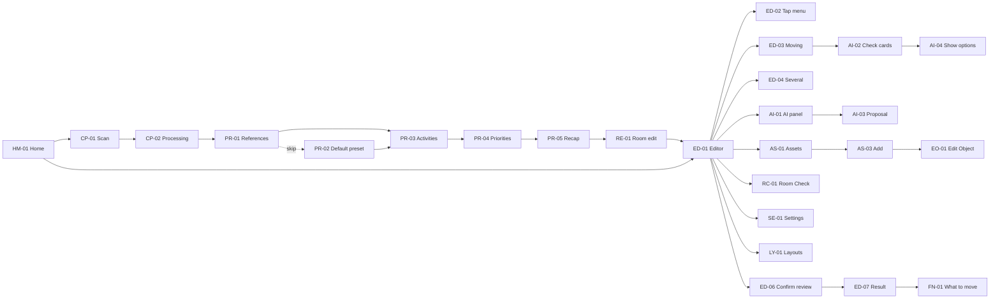

# Sitemap

**Status:** Draft · **Depends on:** [modules/canvas.md](../modules/canvas.md), [modules/ai.md](../modules/ai.md), [modules/guidance.md](../modules/guidance.md) · **Open items:** none

The single source of truth for which screens exist and how they connect ([process.md §7](../process.md)). Flows in `flows/` are routes through these IDs. Detail sections come in step 5, one file per area.

**Kinds:**
- **Base view:** a full screen.
- **Sheet:** slides over a screen.
- **Overlay:** a small layer on a screen.
- **State:** the same screen in another condition.

**The check** tests that every screen can be reached from HM-01, that every screen has a way out, and that every link points to a screen that exists.

## The map

## Rows

| ID | Screen | Kind | Area | Reached from | Leads to | States |
|---|---|---|---|---|---|---|
| HM-01 | Home | Base view | Home | App start · ED-01 Back | CP-01 "Scan my room" · ED-01 open a project | First run (no projects) · with projects · the Zone tile, which does nothing (DEC-008) |
| CP-01 | Scan | Base view | Capture | HM-01 | CP-02 sweep done · HM-01 cancel | Ready · sweeping · done |
| CP-02 | Processing begins | State | Capture | CP-01 | PR-01 automatically | Short "building your room" moment. Processing then continues behind the preferences, with a slim progress line (DEC-006) |
| PR-01 | Name and references | Base view | Preferences | CP-02 | PR-03 Continue · PR-02 Skip | Empty · preset chosen · gallery photo · Pinterest link · stacked cards |
| PR-02 | Default preset notice | Overlay | Preferences | PR-01 Skip | PR-03 Continue · PR-01 Add references | One state: names the preset chosen (DEC-035) |
| PR-03 | Activities | Base view | Preferences | PR-01 · PR-02 | PR-04 Continue or Skip · PR-01 Back | Pre-sorted · dragging · Main full (cap of three) · add your own · tap to cycle (DEC-047) |
| PR-04 | Priorities | Base view | Preferences | PR-03 | PR-05 Continue or Skip · PR-03 Back | None · one · two · three ranked, each with its line (DEC-046) |
| PR-05 | Recap | Base view | Preferences | PR-04 | RE-01 Continue | Still processing (waits) · ready · with or without preferences · with "From what you wrote" items (DEC-048, DEC-039) |
| RE-01 | Room edit | Base view | Room edit | PR-05 (as "Here's what we found") · SE-01 · AI-01 redirect | ED-01 Done or Skip · RE-02 tap an element · RE-03 mark something missed | Setup mode (only the uncertain items highlighted) · later mode (everything tappable) · just corrected (DEC-028) |
| RE-02 | Fix sheet | Sheet | Room edit | RE-01 · EO-01 Not right? · AI-02 Not right? | RE-01 or ED-01 Done · EO-01 Wrong size | What is it? (type chips) · change or add a label on a fixed element (DEC-061) · can it move? · it isn't there · fix a setting (DD F8) |
| RE-03 | Mark something missed | State | Room edit | RE-01 | RE-01 placed or cancelled | Placing a marker · choosing a type |
| ED-01 | Editor | Base view | Editor | RE-01 · HM-01 · SE-01 Clear the room · return from most editor screens | HM-01 Back (nothing staged) · ED-09 Back with staged changes · ED-02 tap an object · ED-03 hold and drag · ED-04 hold-release · ED-05 twist · ED-08 Preview · AI-01 AI pill · AS-01 Assets toggle · RC-01 Room Check · SE-01 ⋯ More options · LY-01 layout name · ED-06 Confirm · AI-02 tap a marker · SE-02 the preferences prompt | First view with the hold hint and the "Clear the room" pill (a layout never edited, DEC-067) · cleared room (only fixed elements) · the preferences prompt (DEC-035) · staged boxes · markers · after Confirm |
| ED-02 | Tap menu | Overlay | Editor | ED-01 tap an object | EO-01 Edit · ED-05 Rotate · ED-01 Remove · AI-01 Ask · ED-01 dismiss | Detected object · added object · linked pair (Unlink) · Ask with a check badge (DEC-050) |
| ED-03 | Moving an object | State | Editor | ED-01 hold and drag · AS-01 or AS-02 drag in · EO-01 Done after adding | ED-01 release (staged, maybe a marker) · AI-02 release with a check that gets a card | Lifted box · snapping to a wall · one signal showing · sliding off a blocked spot |
| ED-04 | Several selected | State | Editor | ED-01 hold-release, then tap more | AI-01 Ask AI · ED-01 Remove or ✕ | Two or more selected · the AI chip shows the selection (DEC-015) |
| ED-05 | Rotating | State | Editor | ED-02 Rotate · ED-01 two-finger twist | ED-01 Done | Rotation drag · snap ticks (DEC-016) |
| ED-06 | Confirm review | Sheet | Editor | ED-01 Confirm | ED-07 Confirm or Confirm anyway · AI-02 tap an open check · ED-01 Discard changes or back | Nothing open · some open (DD F6, DEC-034) |
| ED-07 | Result | State | Editor | ED-06 | ED-01 keep editing · FN-01 What to move · FN-02 Save layout | Models appearing · done (D-27) |
| ED-08 | Preview | State | Editor | ED-01 Preview | ED-01 Preview off | Interface hidden (DEC-013) |
| ED-09 | Confirm or discard first? | Overlay | Editor | ED-01 Back with staged changes · LY-01 switch with staged changes | ED-07 Confirm, then continue · HM-01 or ED-01 Discard, then continue · ED-01 Cancel | Leaving the project · switching layouts (DEC-051, DEC-055) |
| AI-01 | AI panel | Sheet | AI | ED-01 expand the pill · ED-02 Ask · ED-04 Ask AI | ED-01 collapse · AI-03 a proposal · AI-04 options · EO-01 or RE-01 redirect | Collapsed pill (on ED-01) · expanded conversation · asking one question · declining with a pointer |
| AI-02 | Check cards | Overlay | AI | ED-03 release · ED-01 tap a marker · RC-01 tap an item · ED-06 tap an item | ED-01 Keep it, Undo or move on · AI-04 Show options · RE-02 Not right? | One card · a stack ("1 of 3") · hedged · "Before you started" (no Undo) (DEC-040) |
| AI-03 | Proposal | State | AI | AI-01 | ED-01 Apply (staged) · ED-01 Not now | Move, turn, remove or add · restyle across several objects (DEC-018, DEC-026) · several objects brought in, with vertical tabs and a view that follows (DEC-074) |
| AI-04 | Show options | State | AI | AI-02 · AI-01 | ED-01 pick one and Apply · AI-02 Back | Two or three ghosts with costs · "Each of these gives something up" (DEC-032) |
| AS-01 | Assets row | State | Assets | ED-01 toggle to Assets | AS-02 expand · AS-03 the Add tile · ED-03 drag an item in · ED-01 toggle to AI | The active group · an empty group |
| AS-02 | Assets grid | Sheet | Assets | AS-01 expand | AS-01 collapse · AS-03 Add · ED-03 drag an item in | Your room · Added · Suggested (DEC-037) |
| AS-03 | Add: choose a source | Sheet | Assets | AS-01 · AS-02 | AS-04 Gallery · AS-05 Product link · AS-06 Camera · AS-01 cancel | One state |
| AS-04 | Gallery (the prepared set) | Sheet | Assets | AS-03 | EO-01 pick a photo · AS-03 Back | The prepared photos (OI-054) |
| AS-05 | Product link | Sheet | Assets | AS-03 | EO-01 resolved · AS-03 Back | Paste · reading the page · couldn't open the page |
| AS-06 | Camera (simulated) | Base view | Assets | AS-03 | EO-01 capture · AS-03 cancel | Framing · captured |
| EO-01 | Edit Object | Sheet | Objects | ED-02 Edit · AS-04, AS-05, AS-06 after adding · RE-02 Wrong size · AI-01 redirect | ED-01 Done or Cancel · ED-03 Done after adding (DEC-053) · RE-02 Not right? | Detected object · added object (source chip) · size edited · finish preview · finish history · type to confirm · split a merged object (DEC-010, DEC-017, DEC-026, DEC-061) |
| RC-01 | Room Check | Sheet | Room Check | ED-01 the button | AI-02 tap an item · RC-02 Clear checks · SE-02 "Tell us what matters" · ED-01 close | Empty · grouped by object · "Before you started" · no-preferences line (DEC-022) |
| RC-02 | Clear checks confirmation | Overlay | Room Check | RC-01 | ED-01 Clear · RC-01 cancel | One state |
| SE-01 | More options (⋯) | Overlay | Settings | ED-01 | ED-01 Clear the room (the room empties) · RE-01 Room edit · SE-02 Preferences · ED-01 close | One state (DEC-028, DEC-067) |
| SE-02 | Preferences | Sheet | Settings | SE-01 · RC-01 · ED-01 the preferences prompt | SE-01 Back · ED-01 close | References · activities · priorities · "From what you wrote" items (DEC-024, DEC-039) |
| LY-01 | Layouts | Sheet | Layouts | ED-01 layout name · FN-02 saved | ED-01 open, duplicate or start new · ED-09 switch with staged changes · FN-01 What to move · FN-02 Save layout · ED-01 close | One layout · several · asking about staged changes before switching (DEC-009, DEC-051) |
| FN-01 | What to move | Sheet | Finish | ED-07 · LY-01 | ED-01 close | An ordered list · nothing to move · shared (DEC-005) |
| FN-02 | Save layout | Overlay | Finish | ED-07 · LY-01 | LY-01 saved · ED-01 cancel | Naming (DEC-004) |

## Not screens

- **The Zone tile** on HM-01 does nothing this round (DEC-008).
- **Toasts** (Undo after Remove) and the **selection bar** are parts of ED-01, ED-02 and ED-04, not screens of their own.
